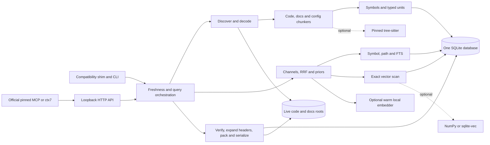
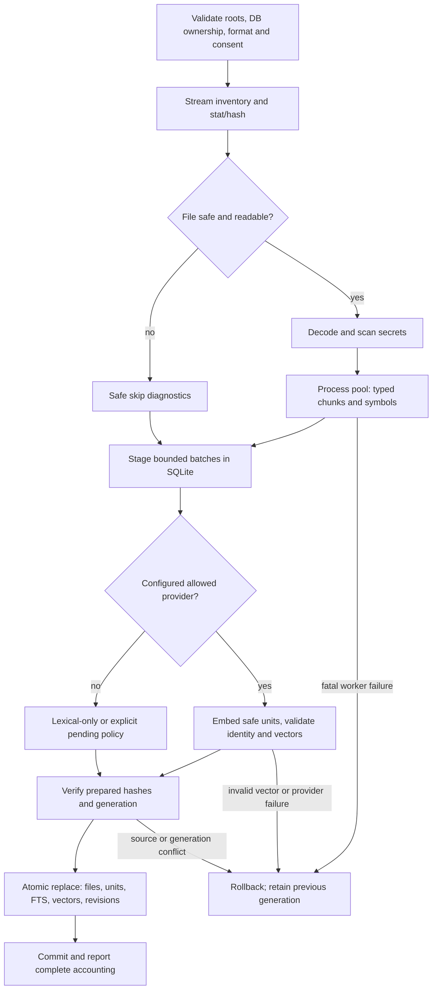
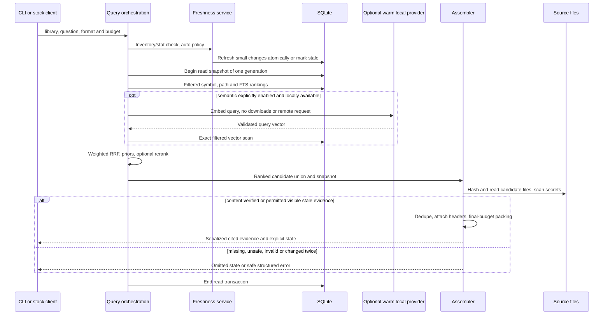
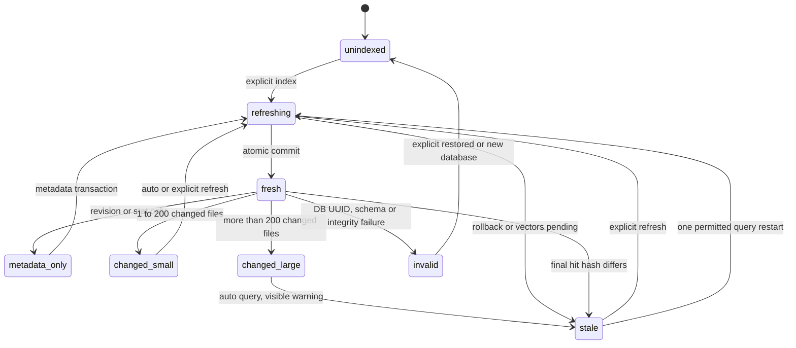

# ADR-002: Local Code and Documentation Retrieval Engine

**Date:** 2026-10-17
**Status:** Accepted orchestrator decisions D1-D14; delegate choices and dissents identified below require orchestrator review. Architecture specification, not evidence of implementation or acceptance.
**Relates to:** [ADR 000](000-local-code-retrieval-storage.md), [PRD](../PRD/local-code-and-docs-retrieval.md), [Context7 research](../retrieval/context7-reverse-engineering.md), [landscape](../retrieval/landscape.md).
**Supersedes / relates:** Retains ADR 000 decisions 1-3: one SQLite system of record, normalized float32 vector BLOBs in a side table, optional sqlite-vec scanning that same table. Supersedes its single-corpus schema, fixed-window chunking, selection caps, two-channel fusion, all-stale-is-error behavior, per-query inference startup and format-7 contracts. NumPy becomes an optional exact scanner. Old measurements remain historical and are not format-8 performance claims.

## 1. Scope

Specify the optional local retrieval capability of `legacy-codebase-workflows`: indexing, decoding, typed retrieval units, deterministic context, exact symbol/path/lexical/vector search, assembly, freshness, consent and CLI/HTTP compatibility. Source trees are read-only. Lexical mode uses Python 3.12+ and SQLite FTS5 without third-party packages. Windows, macOS and Linux are supported. Missing FTS5 is a capability error with a Python-runtime remedy, not a reason to download or substitute a store.

The assigned decisions are D1 package, D2 storage, D3 code chunking, D4 docs/config, D5 decoding/security, D6 search, D7 assembly, D8 freshness, D9 scale, D10 embeddings, D11 consent, D12 interfaces, D13 exclusions and D14 evaluation. A paragraph labeled **Delegate choice** resolves an unspecified implementation detail; defaults and numbers introduced in those paragraphs are choices, not measured optima. No implementation, PRD rewrite, dependency installation or rollout is authorized by this document.

**Delegate choice (scope):** All schema refinements, interface field names, error mappings, algorithms and numeric defaults below that are not explicitly fixed by D1-D14 are delegate choices for orchestrator review. The principal choice groups are labeled individually; their following explanatory paragraphs share that designation.

Index-time LLM summaries, LSP integration, ANN, additional stores and file watchers are deferred. Document Serena/LSP as a separate navigation option for callers/references, with its component-specific licensing as recorded in the research; do not claim snippet retrieval proves complete call graphs. Evaluation tooling is separately owned. No held-out questions may be read by the implementation agent.

## 2. Technology Documentation References

| Technology | Verified Context7 ID or official documentation | Use and verification boundary |
|---|---|---|
| SQLite FTS5 | `/websites/sqlite_docs`; https://www.sqlite.org/fts5.html | Queried 2026-10-17: weighted BM25 columns, smaller scores rank first, built-in k1=1.2 and b=0.75 |
| SQLite transactions | https://www.sqlite.org/isolation.html; https://www.sqlite.org/wal.html | Ordinary read transactions provide WAL snapshot isolation; Python does not need the optional C snapshot API |
| Python sqlite3 | https://docs.python.org/3.12/library/sqlite3.html | Explicit transactions, connection ownership, extension availability |
| Tree-sitter Python | `/tree-sitter/py-tree-sitter`; https://tree-sitter.github.io/py-tree-sitter/ | Queried 2026-10-17: syntax traversal and byte/point source coordinates; implementation must use pinned 0.25.2 API |
| Tree-sitter language pack | https://github.com/Goldziher/tree-sitter-language-pack | Existing `requirements-map.txt` pins 0.13.0; offline grammars, no per-query grammar downloads |
| cAST | https://arxiv.org/abs/2506.15655; https://github.com/yilinjz/astchunk | Algorithm reference from landscape; implement split/merge locally, no third-party skill copying |
| NumPy | https://numpy.org/doc/stable/reference/generated/numpy.frombuffer.html | Optional bounded float32 scan; no matrix persisted outside SQLite |
| sqlite-vec | https://github.com/asg017/sqlite-vec | Retain exactly 0.1.9 and scalar cosine interface from ADR 000; no vec0 duplicate |
| Context7 clients | https://github.com/upstash/context7/blob/f2eef4f49da71a758c91cf6cb97640c8b262ef81/packages/cli/src/types.ts | Pinned ctx7 0.5.13 REST objects, not SDK-normalized objects; research provides source inspection |
| Context7 MCP | https://github.com/upstash/context7/blob/05796c74259a768f45a3f508ae8583df1467a6dd/packages/mcp/src/lib/api.ts | Pinned 4.0.3, two v2 routes, context consumed as text |
| Transformers.js | https://huggingface.co/docs/transformers.js | Existing Node helper and locked runtime retained; local files only during query |
| Local-Python candidates | https://github.com/qdrant/fastembed; https://github.com/minishlab/model2vec | Runtime/model decision deferred to implementation measurements, not an adoption claim |

The current backend, setup generator, project launcher/hook assets, private-retrieval reference and requirements-map pins were inspected as compatibility inputs. `landscape.md` exists; `baseline.md` was absent when work began. Neither the landscape's vendor metrics nor ADR 000's microbenchmarks establish the PRD quality gates. No unverified Context7 ID is introduced.

## 3. Component Design

### 3.1 Package and dependency direction

Place the Python package in `skills/legacy-codebase-workflows/scripts/local_context/`, beside the compatibility entry point `context7_backend.py`. Preserve script invocation and import use. Optional imports are lazy and never make lexical retrieval depend on Node, tree-sitter, NumPy or a model runtime. CLI/HTTP adapters depend on application orchestration; orchestration depends on retrieval/chunking services; services depend on immutable models and storage interfaces. Storage does not import search, HTTP, parsers or embedding providers. No circular imports.

| Module | Responsibility | Direct dependencies / consumers |
|---|---|---|
| `units` | Frozen typed records, enums, source spans, errors, options and reports | Stdlib only; shared by all modules |
| `discover` | Root ownership, excludes, Git inventory/revisions, safe paths, file classification, bounded enumeration | Existing `repo_files` safe inventory primitives; called by index/refresh |
| `decode` | Binary check, decoding, SHA-256, original-line and parser-coordinate mapping, secret scan | Stdlib; called by workers and final verification |
| `symbols` | Definition metadata, tag-query enhancement, deterministic names, identifier splitting | `units`; optional tree-sitter adapter; chunkers and lexical use it |
| `chunk_code` | Syntax recursive split/merge and heuristic fallback | `units`, `symbols`; optional pinned parsers |
| `chunk_docs` | Heading sections, code blocks, HTML and notebook cells | `units`, `chunk_code` for cell/code structure only |
| `chunk_config` | Key/element/property grouping and source ranges | `units`; stdlib parsers where safe, bounded lexical scanners otherwise |
| `store` | Schema, validations, transactions, generation numbers, FTS writes and report cursors | `sqlite3`, `units`; no network or model loading |
| `lexical` | Exact symbol, suffix, path and weighted FTS candidates | `store`, `symbols`, `units` |
| `vectors` | Exact filtered vector scans and engine selection | `store`, `units`; optional NumPy/sqlite-vec |
| `embed` | Provider contracts, identity, consent validation, batching and warm worker | Stdlib HTTP/subprocess; optional local runtime; never reads files itself |
| `search` | Query analysis, channels, RRF, priors and optional rerank | `lexical`, `vectors`, `embed`, `units` |
| `assemble` | Deduplication, header expansion, source verification, final formats and hard budget | `units`, `store`, `decode`; no candidate retrieval |
| `freshness` | Inventory/stat/hash comparison, incremental index/refresh orchestration | `discover`, chunkers, `decode`, `embed`, `store` |
| `http_api` | Loopback request validation and Context7/native serialization routing | `search`, `assemble`, `freshness`, `store` |
| `cli` | Argument validation, progress/error reporting, command dispatch | Application services; compatibility shim calls `cli.main` |

**Delegate choice:** Internal boundaries are typed records rather than arbitrary dictionaries: `FileTask -> ParsedFile`, `ParsedFile -> iterable[UnitDraft]`, `search(Query, Snapshot) -> list[Candidate]`, `assemble(Query, candidates, Snapshot) -> SerializedResponse`. A `Candidate` contains unit ID, channel ranks/raw scores and fused score. A `Query` contains library ID, raw question, filters, mode, budget, limit, refresh policy and format. A `SerializedResponse` owns the exact UTF-8 bytes emitted and the counted character length. Optional provider `describe` returns identity/capabilities; `embed_documents` and `embed_query` return vectors plus input/truncation statistics; `close` terminates owned resources. Errors use typed codes from section 5.5.

### 3.2 Dependency tiers and copied runtime

| Tier | Dependencies | Behavior |
|---|---|---|
| 0 | Python 3.12+, SQLite FTS5 | All formats through deterministic scanners, heuristic code chunks, symbols, BM25, refresh, CLI/HTTP; no model/network |
| 1 | Existing pinned tree-sitter 0.25.2 and language-pack 0.13.0 | Syntax-aware split/merge for available grammars; unavailable/failed grammar falls back with reason |
| Optional vector acceleration | Importable NumPy or pinned sqlite-vec 0.1.9 | Same float32 vectors and exact rankings; no embedding capability implied |
| Optional embeddings | OpenAI-compatible HTTP, measured local-Python adapter, or existing locked Transformers.js helper | Explicit provider/model enablement per library |
| Optional rerank | Existing locked Node helper and pinned cross-encoder files | Offline top-50 scoring; disabled by default |

Keep `requirements-map.txt` pins unchanged until a separate measured dependency change; do not require networkx for retrieval. The chosen local-Python runtime must later receive exact package/model pins, hashes and platform tests. Do not install all candidate runtimes by default.

**Delegate choice:** Extend `setup_context7.py`'s hashed `BACKEND_FILES` inventory with every package `.py` and required static resource, recursively sorted and excluding caches. Include the same payload in native/ZIP builders that previously shipped only the shim. Validate source and copied hashes before launch and keep runtime/cache/database outside every indexed root. Missing package files produce `runtime_incomplete`, never an online repair. Preserve default excludes, isolated client credentials, disabled telemetry, official MCP 4.0.3 and ctx7 0.5.13 locks, and separate hook/AGENTS.md consent gates.

The launcher currently imports `context7_backend`, monkeypatches its `ThreadingHTTPServer` for owned server lifecycle, and redirects its `print`. Preserve compatibility exports `index`, `query`, `serve`, `connect`, `indexed_metadata`, `assert_fresh`, `normalize_excludes`, `RetrievalError` and the existing call signatures. The shim forwards optional new keywords without changing old positional meaning. Its `serve` wrapper passes its exported server factory and diagnostic sink to `http_api`; re-exporting a server class without using the patched factory would break the launcher. Offer an explicit owned-server factory for the updated launcher while retaining the old path during transition. Existing `assert_fresh` remains a strict assertion for legacy callers; native auto-refresh uses the new orchestration API. Legacy metadata projection remains available for a single selected library.

## 4. Data Structures

### 4.1 Schema and identities

Index format is integer 8 in both validated `meta.index_version` and SQLite `user_version`. JSON columns contain canonical validated JSON with sorted object keys; do not depend on optional SQLite JSON extensions. Booleans are integer 0/1. Hashes are lowercase SHA-256 hex of raw source bytes unless explicitly called a derived fingerprint. Timestamps are integer nanoseconds where sourced from stat, UTC ISO strings for reports. All line spans are 1-based and inclusive; parser byte ranges are 0-based and half-open in UTF-8 parser input.

**Delegate choice:** Use integer row IDs for joins and a public `unit_uid` SHA-256 over `(library ID, root ID, relative path, file hash, unit kind, start/end line, cell index, part index, parser fingerprint)`. IDs survive metadata-only commits, change with content/parser changes, and cannot accidentally expand to an unrelated replacement unit. A rename is delete/add. A library has a monotonically increasing `generation`, and a corpus fingerprint over ordered root revisions, file hashes and scope/parser fingerprints. Roots use stable caller-independent IDs `r0`, `r1`, etc., retained across refresh; paths are relative to that root with forward-slash separators, not absolute machine paths.

| Table | Columns and constraints | Indexes / relationships |
|---|---|---|
| `meta` | `key TEXT PRIMARY KEY`, `value TEXT NOT NULL`; format, schema fingerprint, database UUID | Recognized metadata required before mutation; database UUID detects replacement |
| `libraries` | `id TEXT PRIMARY KEY`, `title TEXT`, `description TEXT`, `kind TEXT CHECK code/docs/mixed`, `roots_json TEXT`, `scope_json TEXT`, `parser_json TEXT`, `embedding_json TEXT`, `reranker_json TEXT`, `generation INTEGER`, `corpus_hash TEXT`, `indexed_at TEXT`, `refreshed_at TEXT`, `last_report_json TEXT` | ID pattern `/namespace/name`, including `/local/name`; per-library configuration |
| `files` | `id INTEGER PRIMARY KEY`, `library_id TEXT NOT NULL`, `root_id TEXT`, `kind TEXT CHECK code/docs`, `path TEXT`, `hash TEXT NULL`, `size INTEGER`, `mtime_ns INTEGER`, `encoding TEXT NULL`, `language TEXT`, `format TEXT`, `status TEXT`, `status_reason TEXT NULL`, `parser_tier TEXT`, `parser_fingerprint TEXT`, `embedding_status TEXT` | Unique `(library_id,root_id,path)`; index `(library_id,kind,language,status)`; library FK cascade |
| `units` | `id INTEGER PRIMARY KEY`, `unit_uid TEXT UNIQUE`, `library_id TEXT`, `file_id INTEGER`, `kind TEXT`, `language TEXT`, `start_line INTEGER`, `end_line INTEGER`, `symbol TEXT NULL`, `qualified_name TEXT NULL`, `signature TEXT NULL`, `scope_chain_json TEXT`, `breadcrumb_json TEXT`, `title TEXT`, `description TEXT`, `text TEXT NULL`, `parent_unit_id INTEGER NULL`, `token_estimate INTEGER`, `header_json TEXT`, `header_spans_json TEXT`, `cell_index INTEGER NULL`, `part_index INTEGER`, `part_count INTEGER`, `searchable INTEGER`, `redacted INTEGER`, `oversized INTEGER`, `text_hash TEXT NULL` | Index `(file_id,start_line,end_line)` and `(library_id,kind,language,searchable)`; file and library FKs cascade; parent FK; validate parent belongs to same file/library and is acyclic |
| `symbols` | `id INTEGER PRIMARY KEY`, `library_id TEXT`, `name TEXT`, `name_fold TEXT`, `qualified_name TEXT`, `qualified_fold TEXT`, `kind TEXT`, `unit_id INTEGER`, `path TEXT`, `line INTEGER` | Index `(library_id,name)` and `(library_id,name_fold)`; unique `(unit_id,qualified_name,kind,line)`; unit FK cascade |
| `symbol_suffixes` | `library_id TEXT`, `suffix_fold TEXT`, `symbol_id INTEGER` | Primary key `(library_id,suffix_fold,symbol_id)`; symbol FK cascade; bounded separator-component suffixes, not arbitrary substring index |
| `units_fts` | FTS5 columns in order: `title_symbols`, `identifier_tokens`, `path_tokens`, `body`; rowid equals unit integer ID | `unicode61`, ordinary content-bearing FTS table; writes/deletes explicit in same transaction as units |
| `unit_vectors` | `unit_id INTEGER PRIMARY KEY`, `embedding BLOB`, `input_hash TEXT`, `input_tokens INTEGER NULL`, `truncated INTEGER`, `embedded_at TEXT` | Unit FK cascade; one little-endian normalized float32 vector per eligible searchable unit |
| `file_diagnostics` | `id INTEGER PRIMARY KEY`, `library_id TEXT`, `root_id TEXT`, `path TEXT`, `stage TEXT`, `code TEXT`, `message TEXT` | Index `(library_id,stage,code)`; bounded safe message, no source lines or secret literals |

`units.kind` is exactly `code-definition | code-block | doc-section | doc-code | config | notebook-cell | fallback`. Provenance is independently `files.kind=code|docs`; a SQL config unit can have code provenance and a documentation code block has docs provenance. `files.status` is `indexed|redacted|skipped|unreadable|binary`; a partly redacted file is `redacted` and may still have safe units. Diagnostic-only files have no units. `embedding_status` is `disabled|complete|pending|error`. Unavailable files retain diagnostics/stat if available, not old source text presented as current.

Root objects in `roots_json` contain root ID, canonical absolute location (local metadata only), declared role code/docs, detected revision or `non-git`, and Git worktree identity. Nested docs roots take ownership only of documentation-format files; code files beneath them remain eligible under the code root. Same physical file is indexed once within a library. Reject equal roots with conflicting roles, docs roots containing a code root, symlink roots and ambiguous overlaps before any write. Docs-only mode uses docs roots without a positional code root. Separate libraries may intentionally index the same physical files.

Use composite ownership checks/FKs so a unit cannot claim a library different from its file. `start_line >= 1`, `end_line >= start_line`, nonnegative token estimates and valid part ranges are mandatory. Structural parent records for oversized definitions/sections are `searchable=0`, store the exact original span and header once, and do not receive FTS/vector rows. Searchable children cover the full body. Small definitions are searchable directly; no duplicate parent copy. Merged tiny siblings retain separate symbol rows pointing to the merged unit, with individual declaration lines.

Every searchable safe unit has exactly one FTS row; path-only redacted units have only safe path tokens and fixed redaction marker, never symbol/title/body values derived from affected text. Vectors exist only for safe searchable units, share the selected library's embedding identity/dimension, and have byte length `4 * dimension` and finite nonzero norm within 1e-3 of one. Stale vector rows are deleted in the same transaction as replaced units. No second vector copy, native table or cache is authoritative.

### 4.2 Decoding and secret handling

**Delegate choice:** Hash raw bytes first. Recognize UTF-8 BOM, UTF-16LE BOM and UTF-16BE BOM before binary detection; BOM-confirmed UTF-16 is exempt from the raw NUL rule and must decode strictly. Otherwise any NUL byte marks binary. Decode strict UTF-8, then declared `--encodings` in order, then latin-1. Default fallback list is empty because cp1250 and cp1252 can both decode plausible but wrong prose; users can set `--encodings cp1250,cp1252`. Final fallback records exactly `latin-1 (assumed)` and reports an assumed-decoding count. BOM-confirmed malformed text is skipped with an encoding error, not silently reinterpreted. No replacement-character decoding.

Keep original decoded lines and their original line endings as the text authority; display may serialize LF with `newlineNormalized=true`. Build an explicit line/UTF-8-byte mapping for tree-sitter after decoding. Tree-sitter points never index the original cp1250 or UTF-16 byte stream directly. Header metadata has its own source spans, so repeating a signature does not falsify the body range. Hash verification always compares original raw bytes. Skip non-UTF-8/control-character paths with escaped diagnostics as today.

Retain secret-filename/directory filtering from `repo_files`, report excluded paths without reading them, and preserve symlink, traversal, ignore and runtime-outside-root guards. Default-on content scanning recognizes PEM private-key envelopes; AWS access-key ID formats; common Google/GitHub/provider key formats with strict prefixes and length/alphabet; and literal assignments to password/passwd/pwd/client_secret/api_key/secret/token in config formats. Empty values, documented placeholders, environment substitutions and variable references are not literal secrets. Exact patterns and placeholder rules are versioned as part of the parser fingerprint and regression fixtures use synthetic values only.

**Delegate choice:** Scan the whole decoded file before producing derived titles/descriptions or sending any embedding input. Also scan decoded config string values, notebook cell sources and entity-decoded HTML before persistence, mapping findings back to their raw source envelope; escaping must not bypass the content check. Recognize both equals-style and colon-style literal config assignments. An affected unit and every overlapping/containing parent or derived header/description reference are path-only: `text=null`, `redacted=1`, fixed title/description `Redacted source content`, no symbols, no vector and no cached sensitive substrings in header/metadata fields. Safe disjoint units may remain. A multi-line key redacts its entire enclosing unit. Expand rescans its whole source file and refuses any requested range intersecting a secret or any derived secret-bearing header. Diagnostics contain pattern names and line ranges only. `--no-secret-scan` is an explicit per-library saved policy change that forces reprocessing and is visible in status; it never disables secret-filename filtering. No scanner promises all secrets are detected.

### 4.3 Code chunking algorithms

**Delegate choice:** `--chunk-chars` remains accepted, but format 8 measures non-whitespace Unicode code points, default 1,500, valid 128..12,000. Count body only; headers are separately budgeted during embedding/assembly. `MIN_MERGE_CHARS=300`, `MAX_HEADER_CHARS=2000`, no default overlap for syntax chunks, fallback overlap up to eight lines and at most 20% of target body characters. Every chunk must advance at least one original line. An indivisible over-budget line remains whole, marked oversized; do not alter source or silently truncate at index time.

Tier 1 parses decoded UTF-8 with any grammar available from the pinned language pack. Build candidate boundaries from syntax child intervals, including unnamed tokens and gaps so comments, decorators, imports and whitespace are not lost. Recurse into a node when its non-whitespace span exceeds the target; keep a fitting node whole. Convert cuts to whole-line boundaries, suppress zero-length/duplicate cuts, then greedily merge consecutive siblings under the same scope while their combined body fits the target. Prefer retaining definitions >=300 characters separately; merge smaller siblings while recording all declaration symbols. Adjacent nodes sharing a line share a single line envelope rather than duplicate slices. Oversized leaves fall back to whole-line windows. All nonblank lines must belong to at least one searchable unit; separator blank lines attach to the following unit, trailing blanks to the preceding unit. Metadata-only parents are excluded from this coverage count.

Definition recognition is separate from splitting: use named fields such as name/declarator, node-type families containing function/method/constructor/class/interface/struct/enum/trait/module/procedure/trigger/view/package, then vendored tag-query captures when available. Unknown node types still split structurally and may lack a symbol. A deterministic header contains root-qualified path, language, outer-to-inner scope chain, original multiline signature up to the body opener, and contiguous leading doc comments/annotations. Header limits produce an explicit `headerTruncated` flag and retain exact source spans for expansion. No generated explanation replaces missing comments; description is empty when absent. Oversized definitions have a parent and consecutive parts with the same header and part numbers.

Parse errors do not discard valid subtrees. Use Tier 0 for ERROR regions, and for the whole file if parser invocation fails or the ERROR-span union exceeds 20% of nonblank lines. Record `parser_fallback_reason`. Missing grammar/tag queries are capabilities, not index failures. A full-file syntax error still has lexical coverage.

Tier 0 uses anchored line recognizers and conservative scope/indentation/brace boundaries. Families include Python/Ruby definitions; C/C++/Java/C#/JS/TS/PHP/Go/Rust/Kotlin/Swift/Dart declarations; VB/VB.NET Sub/Function/Property/Class/Module; Pascal/Delphi procedure/function/type; SQL/PL-SQL/T-SQL CREATE [OR REPLACE|ALTER] PROCEDURE/FUNCTION/TRIGGER/VIEW/PACKAGE; COBOL divisions/sections/paragraph labels; shell functions and PowerShell function/filter/class; Perl subs and R named function assignments. Treat comments/strings conservatively; uncertain blocks are `code-block`/`fallback`, never asserted semantic definitions. Split oversized spans at blank lines, indentation decreases, then whole-line windows, and merge tiny neighboring spans within the same scope. Unknown text uses blank-line paragraphs plus the same whole-line bound. These recognizers provide useful names, not compilation or language-server accuracy.

**Delegate dissent:** D3's language-agnostic syntax splitting is implementable for every available grammar, but reliable definition names, signatures and scope chains are grammar-dependent. The ADR retains generic splitting and deterministic best-effort metadata; claiming complete symbol extraction for every grammar would be incorrect.

### 4.4 Documentation, notebooks and configuration

**Delegate choice:** A heading stack produces breadcrumbs from document title through current section. Markdown/MDX recognizes ATX and setext outside fences; RST recognizes consistent underline/overline adornments and code-block/literal indentation; AsciiDoc recognizes `=` headings and `----` listings; HTML uses `html.parser` heading/pre/code events with source offsets; plain text uses paragraphs and filename title. MDX is scanned as text, never imported/rendered. HTML is never fetched/rendered and scripts/styles are excluded from semantic body extraction but remain in the raw source hash. Entity-decoded or notebook-decoded content is labeled transformed; its source range cites the raw file and raw expansion stays available.

Each section has a `doc-section`, split into paragraph-sized parts only when needed; preserve heading context on every part. Each fenced/literal/pre code block has an independently searchable `doc-code` child with language and nearest preceding prose paragraph in the same section as its description. Use at most 1,000 description characters, mark any shortening, and record description spans. Do not choose an unrelated preceding paragraph across a heading. Short snippets stay intact; an oversized block stays one oversized unit to preserve author boundaries and is shortened only by explicit output excerpting. When a section contains separately indexed code blocks, its whole-span parent is metadata-only and its searchable prose children each cover one contiguous original range between those blocks. Never remove an interior block from text while retaining a supposedly contiguous original range. This prevents systematic prose/code double counting.

Notebook JSON is parsed without executing cells or inspecting output attachments. Index markdown and code cell source as `notebook-cell` units, with heading or code metadata and code-block children when useful. Record zero-based `cell_index`, cell-local lines and language from notebook metadata. A JSON token/offset scanner maps source strings to their physical JSON line envelope; multiple cell lines may map to one JSON line, so set `lineMapping=approximate`. Normal code/docs units use exact mapping. Parent/header metadata cannot pretend decoded cell lines are literal JSON file lines. Malformed notebook JSON falls back to safe text windows with a warning and no invented cell mapping.

Config units group XML top-level children including Maven/csproj, JSON object keys/array groups, TOML sections, YAML top-level mapping entries/indented blocks, properties/INI sections or shared dotted prefixes, Gradle top-level blocks, and SQL schema CREATE statements. Use stdlib JSON/TOML validation and position scanners for original spans; YAML/Gradle scanners are lexical and never evaluate tags or scripts. XML rejects external entities/DTD processing and falls back to text on unsupported constructs. A multiline value is never omitted; an oversized group uses the code/window splitter and repeats its key/element context. Malformed config is indexed as fallback with diagnostic rather than partially disappearing.

## 5. Interface Contracts

### 5.1 CLI and configuration

Keep `python scripts/context7_backend.py` as entry point. All commands accept `--database PATH`; native JSON is the default query output, `--format text|context7-json|json` selects assembly. Query text is 1..500 Unicode characters, filters are validated enum/language names, default result limit remains 5 and supported limit is 1..50. `--tokens` is a final-output estimate budget, default 4,000, supported 256..32,000. Flags with ambiguous combinations fail before filesystem/model changes.

| Command | Inputs | Output / semantics |
|---|---|---|
| `index [ROOT]` | Required `--library-id`; repeatable `--docs-root`; title/description; existing excludes/chunk/model/runtime/vector flags; `--jobs`, `--encodings`, `--no-secret-scan`, `--max-files`, `--max-units`, `--max-file-bytes`, `--discovery-limit`; provider flags | Add/update only this library atomically; ROOT omitted for docs-only. Counts by corpus/format/tier/encoding, skips/redactions, timings, limits and revision map |
| `refresh` | `--library-id` optional only for a single-library DB; `--all` explicit for all; `--jobs`; `--verify-all` | Saved scope/policy/provider, stat then hash; per-file added/changed/removed/metadata-only report. No model download and no implicit config reset |
| `query` | Existing `--query`, `--mode lexical\|semantic\|hybrid`, `--rerank lexical-symbol\|cross-encoder`, `--limit`, `--vector-engine`; library/kind/language; `--tokens`, `--format`, `--refresh auto\|off\|strict` | Budgeted source evidence, channel/coverage metadata in native JSON, explicit empty/stale/truncation state |
| `resolve` | `--library-name`, optional `--query`, `--limit 1..50` | Ranked local libraries only; exact ID then casefolded title/ID token/description matches; deterministic ID ties |
| `expand` | Library; exactly one of `--unit-id UID` or `--path PATH --root-id ID --start-line N --end-line N`; tokens/format | Fresh exact unit/range, optional metadata header; no arbitrary absolute path; max 2,000 lines and file byte bound; reject an over-budget exact range instead of silently shortening |
| `status` | Optional library; `--verify-all` for full hash audit | Format, generations, roots, revisions, counts, capabilities, embedding coverage, consent identities, scan policy, freshness and report summaries; no secret values |
| `serve` | Existing host/port/default-mode/default-rerank/default-vector-engine; `--refresh auto` default, tokens/default library | Loopback server, validated defaults, warm optional worker; startup diagnostics on stderr, MCP stdout clean |

**Delegate choice:** Native multi-library queries select exactly one library. Omitting library in a multi-library database gives `library_required`; `resolve` can search all. For old index invocations, an explicit code root and legacy model flags still work. `--embed-model` without a provider selects `transformers-js` but no longer authorizes a download. Keep old flag spellings; compatibility does not bypass the new download/remote-consent gates. Index omission of `--exclude` still resets scope to empty as documented; refresh always reuses saved scope. Changing parser/scanner/encoding/chunk options reprocesses affected library files; changing only vector scanner does not re-embed.

Example lexical index:

```text
python scripts/context7_backend.py index /work/sample --database /work/indexes/sample.sqlite --library-id /local/sample --docs-root /work/manuals
```

Example budgeted query:

```text
python scripts/context7_backend.py query --database /work/indexes/sample.sqlite --library-id /local/sample --query "Where are retries configured?" --tokens 2000 --refresh auto
```

Example exact expansion:

```text
python scripts/context7_backend.py expand --database /work/indexes/sample.sqlite --library-id /local/sample --path src/retry.py --root-id r0 --start-line 10 --end-line 24 --tokens 2000
```

`LEGACY_EMBED_BASE_URL` and `LEGACY_EMBED_MODEL` provide defaults for explicit embedding enablement; ambient environment alone never enables semantics. `LEGACY_EMBED_API_KEY_ENV` names the environment variable to read inside the provider, never a key value. Equivalent flags are `--embed-provider`, `--embed-base-url`, `--embed-model`, `--embed-api-key-env`, `--model-revision`, `--model-dir`, `--download-model`, `--allow-remote-embeddings`. Resolve explicit flags before environment before saved config. Save key variable names only; redact authorization and source-bearing provider error bodies. Keep existing test-only environment switches documented in the reference.

### 5.2 HTTP routes and client contracts

All routes are GET. Bind only `127.0.0.1`, `::1` or `localhost`; validate Host authority and supplied port, reject credentials/malformed/nonloopback authority and untrusted Origin. No CORS wildcard, authentication, shared-service guarantees, redirects to cloud or cloud fallback. Validate each newly opened DB's UUID/schema/metadata; a replacement is `index_replaced`, not a silently accepted corpus. Connections are request-owned; HTTP SQLite busy timeout remains one second, CLI five seconds.

**Delegate choice:** Retain 2,048-character request-target limit for existing calls; reject excess with 413. Validate duplicate singleton parameters instead of taking an arbitrary value. Loopback status/expand provide no arbitrary file read; lookup always belongs to indexed library/root and safe relative path. HTTP serves one selected library for a request, with direct `kind=code|docs`, `language`, `mode`, `rerank`, `limit`, `vectorEngine`, `tokens`, `refresh` optional. Stock clients use configured serving defaults and do not need these extras.

| Route | Request | Success |
|---|---|---|
| `/api/v2/libs/search` | `libraryName` required, `query` optional | `{results:[LibraryResult]}`; empty list is valid |
| `/api/v2/context` | `libraryId`, natural-language `query`, optional `type=txt\|json`, `tokens` and direct filters | Default `txt` for pinned MCP's missing type; explicit JSON has pinned code/info shape |
| `/api/v2/local/expand` | `libraryId`, `unitId` or `rootId,path,startLine,endLine`, `tokens` | Native bounded expansion object; live source verification required |
| `/api/v2/local/status` | Optional `libraryId`, `verifyAll=1` | Native status; no source bodies or credentials |

`LibraryResult` has `id,title,description,branch,lastUpdateDate,state,totalTokens,totalSnippets`. State is `finalized` for a queryable generation, `error` for unusable state; do not fabricate popularity/trust/benchmark scores. Branch is the recorded primary revision or `non-git`; native metadata retains all root revisions. Resolve query influences local lexical tie ranking only. `totalTokens` sums unit estimates and is explicitly approximate.

Example request:

```text
GET /api/v2/context?libraryId=%2Flocal%2Fsample&query=retry%20policy&type=json&tokens=2000
```

Pinned JSON contract example, with illustrative source values:

```json
{"codeSnippets":[{"codeTitle":"RetryPolicy.run","codeDescription":"Retry a failed operation. Source: src/retry.py:L10-L12; library:/local/sample; root:r0; kind:code; sha256:<64-hex>; revision:<commit>; freshness:fresh; unit:<uid>","codeLanguage":"python","codeTokens":12,"codeId":"local-context:///local/sample/r0/src/retry.py#L10-L12","pageTitle":"src/retry.py","codeList":[{"language":"python","code":"def run(operation):\n    return operation()\n"}]}],"infoSnippets":[{"pageId":"local-context:///local/sample/r1/retries.md#L3-L4","breadcrumb":"Manual > Retries","content":"Retry policy is configured per client.\nSource: retries.md:L3-L4; library:/local/sample; root:r1; kind:docs; sha256:<64-hex>; revision:<commit>; freshness:fresh; unit:<uid>","contentTokens":62}]}
```

The example defines field placement; placeholders and example token numbers are not wire fixtures. Contract tests compute actual estimates. `codeTokens` counts joined codeList bodies; `contentTokens` counts the actual info content including appended provenance. `pageId` and `breadcrumb` replace the current incorrect info `pageTitle/description` projection. Code definitions, blocks, config and notebook code map to `codeSnippets`; prose maps to `infoSnippets`. A `doc-code` remains docs provenance in visible description. All sources are percent-encoded local identifiers with root and line range; `codeId` is a source identifier, while native `unitId` is the unique unit identity. No HTTP handler dereferences the custom source URI.

Text output has a level-three deterministic title, `Source: path:Lstart-Lend`, library/root/provenance/hash/revision/freshness, real description or empty description, then a language-tagged fenced body and separator. Select a fence longer than any matching run in the body. Source text is labeled quoted data; no engine action interprets source instructions. Put stale warnings in the top preamble and inside every stale item's description/content so MCP text forwarding and CLI JSON normalization both expose them. Native metadata alone is insufficient for stock clients.

### 5.3 Native response and expansion

**Delegate choice:** Native JSON retains existing top-level `libraryId,mode,reranker,vectorEngine,corpusId,results,message` and adds `indexVersion,generation,revisions,freshness,budget,coverage,warnings`. Each result has `unitId,unitKind,language,title,description,header,headerSpans,text,score,source` plus optional `rerankScore`. Source retains `kind,path,startLine,endLine,fileSha256,revision,corpusId`, and adds `libraryId,rootId,liveFileSha256,verifiedAt,freshness,encoding,lineMapping,cellIndex,cellStartLine,cellEndLine,redacted`. Library root revisions supply per-file revision; no single commit is invented for independent docs roots. Native diagnostic channel ranks are optional under `--explain` and consume the same response budget.

Illustrative envelope shape:

```json
{"indexVersion":8,"libraryId":"/local/sample","generation":3,"mode":"lexical","reranker":null,"vectorEngine":null,"corpusId":"<sha256>","revisions":{"r0":"<commit>","r1":"non-git"},"freshness":{"state":"fresh","changedFiles":0},"budget":{"requestedTokens":2000,"usedEstimatedTokens":180,"estimator":"ceil(chars/4)","characters":720},"coverage":{"returned":1,"omittedForBudget":0,"embeddingCoverage":0},"results":[{"unitId":"<uid>","unitKind":"code-definition","language":"python","title":"RetryPolicy.run","description":"","header":{"scope":["RetryPolicy"],"signature":"def run(operation):"},"headerSpans":[],"text":"def run(operation):\n    return operation()\n","score":0.04,"source":{"libraryId":"/local/sample","rootId":"r0","kind":"code","path":"src/retry.py","startLine":10,"endLine":12,"fileSha256":"<sha256>","liveFileSha256":"<sha256>","revision":"<commit>","corpusId":"<sha256>","freshness":"fresh","encoding":"utf-8","lineMapping":"exact","redacted":false}}],"warnings":[],"message":null}
```

Numbers/placeholders above illustrate types only; serializers compute the final envelope's exact count. Expand returns the same native result structure, sets `expanded=true`, and returns exactly requested inclusive lines; no reranking or silent clipping. Unit expansion can target an unchanged parent definition, but an oversized full definition beyond limits yields `range_too_large` and suggests an explicit range. A changed/deleted unit ID yields `unit_stale`/`unit_not_found`, never an unrelated span. Approximate notebook range expansion returns raw JSON lines and separate cell metadata; cell decoded text expansion by unit is explicitly labeled transformed.

### 5.4 Empty, stale and partial results

A successful no-match returns empty arrays/results and `message="No matching indexed evidence. Empty results are not proof of absence; use direct search."` Text gives the same message. Distinguish `no_match`, `all_redacted`, `budget_omitted` and `stale_omitted` in native reason fields. Results omitted for budget and model truncation are explicitly reported. No confidence or semantic completeness is inferred from a rank score.

Visible stale results may contain old indexed source only under the verified stale policy in section 6.6. Record indexed and live hashes separately, the indexed revision and current root revisions, and instruct `refresh`. Missing/unreadable/symlink-replaced sources and newly detected secrets never produce a cached body. If no safe body can be emitted, return an explicit stale response/error, not an unexplained empty success.

### 5.5 Error codes and recovery

**Delegate choice:** Stable JSON errors have `error` code, safe `message`, `recovery`, and empty code/info arrays for context errors. CLI success including visible stale/empty is exit 0; usage/validation exit 2; format/corruption exit 3; source/resource/contention exit 4; model/consent exit 5. Existing wrappers may map nonzero to their historical generic nonzero. Error JSON is independent of successful evidence budgets.

| Code family | HTTP | Recovery / invariant |
|---|---|---|
| `invalid_argument`, `invalid_scope`, `invalid_range`, `budget_too_small` | 400 | Correct flags/parameters; no writes |
| `loopback_required`, `secret_range` | 403 | Use local authority / safe range; no cached body leak |
| `library_not_found`, `unit_not_found`, `route_not_found` | 404 | Resolve or select existing indexed source |
| `index_version_unsupported` | 409 | Reindex into format 8 explicitly; never migrate during query |
| `index_invalid`, `index_replaced` | 409 | Restore recognized database or use new path; no destructive repair |
| `source_changed`, `unit_stale`, `refresh_required` | 409 | Run refresh; stale policy may instead produce visible 200 partial results |
| `index_busy`, `generation_conflict` | 409 | Wait for writer then retry manually; no unbounded internal retries |
| `request_too_large`, `range_too_large` | 413 | Smaller request/range or explicit configured bound |
| `resource_limit`, `discovery_limit` | 413 | Scope roots or raise documented bound; previous generation intact |
| `consent_required`, `remote_query_forbidden` | 403 | Explicit setup consent, local query provider or lexical mode |
| `model_unavailable`, `provider_unavailable`, `vector_adapter_unavailable` | 503 | Restore local pinned capability or explicitly choose lexical; no cloud fallback |
| `embedding_invalid`, `embedding_incomplete`, `model_identity_mismatch`, `adapter_version_mismatch` | 409 | Correct/re-embed identity or complete missing vectors; wrong installed adapter never silently ignored |
| `runtime_incomplete`, `fts5_unavailable`, unexpected database I/O | 503 | Verified setup/runtime restoration; safe failure diagnostics |

## 6. Technical Decisions

### 6.1 Storage, concurrency and format migration (D1, D2)

**Status:** Accepted.
**Date:** 2026-10-17.
**Context:** Corpus isolation and atomic lexical/vector refresh must coexist with simple offline distribution.
**Decision:** One SQLite database with the schema above, one writer, explicit reader transactions, and cascade-safe replacement of a file's units/FTS/vectors. No external vector authority.
**Rejected alternatives:** Multiple independent stores require cross-store reconciliation; JSON/array files lose atomic relational updates; retaining format 7 cannot represent the new units/libraries.
**Consequences:** Portable single authoritative file and consistent queries; WAL has transient `-wal/-shm` companions and is not a cross-machine database service. Checkpoint before copying, or use SQLite backup API; do not copy only the live DB file.
**Review trigger:** Multiple required writers, remote database sharing, or measured exact-scan bottlenecks.

**Delegate choice:** Use WAL and foreign keys, explicit BEGIN read snapshots, BEGIN IMMEDIATE writer transactions, and a monotonically increasing library generation checked before applying prepared changes. Parsing occurs into bounded batches/temp staging in the same database, not a second store; one commit publishes the entire requested library refresh. Stage while retaining the prior live generation, validate all stages and source hashes, then apply file/unit/FTS/vector replacements and revisions atomically. A fatal parse worker, invalid vector, disk failure or cancellation rolls back; individual unreadable/oversized files commit diagnostic skip state with prior bodies removed. If generation changed since preparation, abort with `generation_conflict` rather than overwrite another writer. Clean uncommitted staging on rollback; no model or source content in failure logs.

Format-7 and older queries/status serving return `index_version_unsupported` with the detected format and explicit reindex command. Index validates recognizable old metadata and ownership before replacement; unrelated/empty-metadata/unknown SQLite files are refused. For format 7, `index` may rebuild recognized tables in one transaction, retaining the old committed index until success. No unit/vector reuse across the format bump. An older vec0 index still needs its pinned extension to remove the virtual table, or a new DB path. Schema/metadata mismatch never triggers automatic dropping. Fresh destination migration is the safest general option and leaves the original file available.

### 6.2 Chunking, decoding and security (D3, D4, D5)

**Status:** Accepted.
**Date:** 2026-10-17.
**Context:** Fixed line windows omit ownership and docs explanation; mixed encodings and ordinary config files can hide both useful text and secrets.
**Decision:** Use sections 4.2-4.4, deterministic comments/headings only, uniform typed units, and source-faithful ranges. Record parser/scanner/encoding fingerprint and rebuild when semantics change.
**Rejected alternatives:** One definition per unit cannot bound large functions/classes; parser/tag-query-only support excludes legacy languages; inferred LLM descriptions introduce unverified claims and invalidation work.
**Consequences:** Baseline works without parsers; optional grammar support improves boundaries. Heuristic labels, assumed encodings, transformed notebook text and secret-scan limits remain visible.
**Review trigger:** Evaluation shows persistent boundary misses for a language/format or secret false positives make a corpus unusable.

### 6.3 Search channels, scoring and filters (D6)

**Status:** Accepted.
**Date:** 2026-10-17.
**Context:** Exact ownership, prose descriptions, paths and semantic similarity supply complementary evidence on incompatible raw-score scales.
**Decision:** Analyze once, filter before channel limits, retrieve channel rankings, weighted RRF, deterministic priors, optional top-50 cross-encoder. Default lexical mode combines symbol, path and FTS; semantic mode uses dense candidates with exact-identifier anchoring; hybrid uses all four.
**Rejected alternatives:** All-terms-required FTS loses paraphrase recall; dense-only default loses exact names; blending uncalibrated BM25/cosine produces unstable weights.
**Consequences:** Weights are named tuneable constants and require development-set evaluation; cross-encoders cannot recover candidates absent from every channel.
**Review trigger:** Per-kind development recall/coverage regresses or relevant evidence regularly lies below candidate depth.

**Delegate choice:** Query analysis retains first 32 unique non-stopword Unicode word/identifier/path terms, preserves original identifier tokens, and emits casefolded camelCase/acronym/snake_case/dotted/path components. Preserve original symbols in the symbol table for case-sensitive match. Quote each FTS term and OR them, never execute user FTS operators. Keep stopword removal out of exact-symbol matching. Names consisting entirely of stopwords still try exact/path channels. Casefold normalization is Python Unicode casefold in indexed auxiliary fields; FTS uses its own unicode61 normalization consistently at index/query time. Populate `title_symbols` with title, breadcrumb, symbol names and signature; `identifier_tokens` with original identifiers plus their split components from safe header/description/body; `path_tokens` with root-relative path and its filename/component tokens; `body` with safe description, header comments and original unit text. These are derived retrieval fields, not a replacement for the source-faithful `units.text`.

| Channel | Ranking before fusion | Default constant |
|---|---|---|
| Exact symbol | Exact qualified/name case-sensitive, then casefold equality, then separator-boundary qualified suffix; declaration line/unit ID ties | `W_SYMBOL=2.5` |
| Path/filename | Full relative path equality, basename equality, component suffix, then matched path-token count; shorter path then ID | `W_PATH=1.5` |
| FTS BM25 | `bm25(units_fts,8.0,5.0,3.0,1.0)` ascending; ID tie | `W_FTS=1.0` |
| Dense | Descending cosine, unit ID tie, no universal similarity cutoff across unrelated models | `W_DENSE=1.0` |

Candidate depth per channel is `min(500,max(100,10*limit))`, configurable 50..2000; default limit 5 therefore retrieves 100 per channel. Deduplicate each channel by unit before assigning 1-based ranks. Parameter `RRF_K=60`; `RRF(u)=sum over present channels c of W_c/(60+rank_c(u))`. Missing channels contribute zero. Library/kind/language filters apply inside each channel before top-k, including dense scan and symbol expansion, so another corpus cannot consume the candidate budget.

Multiply RRF by priors: `P_DEFINITION=1.15` for code-definition; `P_HOWTO_DOCS=1.20` for docs when question contains how/how-to/example/usage/tutorial; test path `0.80`, generated `0.50`, vendored `0.50`, minified `0.25`, otherwise 1.0. Path priors multiply when several apply; all are configurable positive values, logged with eval runs. Existing skipped dependency/build directories stay skipped unless explicit include policy enables them; downweights do not make excluded files searchable. Minified detection is a versioned lexical rule: JS/CSS filename `.min.*` or a >2,000-character line with whitespace ratio below 5%. Final pre-rerank score is `RRF * product(priors)`; ties use unit ID. Scores are ordering signals, not probabilities.

A question consisting solely of one identifier-like token with an underscore, uppercase or qualification/path separator requires an exact identifier/path anchor, even in semantic mode; zero anchors gives explicit no evidence rather than a misleading neighbor. OR-split identifier fragments may support broader questions but do not prove a requested absent API exists. Preserve `--rerank lexical-symbol` as an explicit compatibility option that adds deterministic whole-symbol/path match tier ordering before fused-score ties; no second hidden bonus in defaults.

Cross-encoder scores only the top 50 fused candidates using header + body, existing pinned `Xenova/ms-marco-MiniLM-L-6-v2` revision `a09144355adeed5f58c8ed011d209bf8ee5a1fec`, batch eight and existing 512 pair-token limit. Record input truncation. Sort scored candidates by logit then fused score/ID; append unscored candidates in fused order as assembly fallbacks. Missing model, invalid scalar or timeout on explicit rerank fails clearly, without silently substituting a ranking. Default rerank is off.

### 6.4 Exact vectors and embedding providers (D2, D10)

**Status:** Accepted, local-Python model/runtime selection deferred by D10.
**Date:** 2026-10-17.
**Context:** Semantic retrieval is optional and must not impose a GPU, cloud account or query-time downloads.
**Decision:** Provider interface supports `none` default, `openai-compatible`, `local-python`, `transformers-js`. Store identity per library and exact normalized float32 vectors; query identity must equal document identity.
**Rejected alternatives:** Fake hash embeddings do not establish semantic quality; a mandatory daemon or transformer dependency breaks lexical/offline baseline; int8 adds calibration/recall complexity without a measured need.
**Consequences:** Bounded exact scans scale linearly; optional providers have explicit capability failures, and a remotely built vector index alone does not supply a legal offline query embedder.
**Review trigger:** Real corpus scan p95 exceeds 200 ms with the supported optional accelerator, or a million-unit corpus demonstrates a measured need for ANN/quantization.

**Delegate choice:** Do not adopt int8 quantization. Default saved vector preference remains `stdlib` for old flags; its implementation uses NumPy when importable and reports `numpy`, otherwise `math.sumprod` and reports `stdlib`. Explicit `--vector-engine numpy` requires it. Explicit `sqlite-vec` requires exactly 0.1.9; `auto` tries sqlite-vec then NumPy/stdlib only for unavailable capabilities, never for an installed broken/wrong-version adapter. Scan filtered vectors in batches of 4,096, keep a bounded top-k heap, and do not build an unbounded all-vector matrix. Normalize/validate vectors once on write, validate dimension/finiteness on read; compare engine results with float tolerances and deterministic ties within 1e-6 similarity. A query vector has the same validation. No universal 0.30 threshold survives a model change.

Embedding identity contains provider, model ID, immutable revision or caller-declared endpoint version, dimension, normalization, task-prefix/pooling/tokenizer settings, and local manifest hashes where applicable. The base URL is recorded separately, without userinfo/query/credentials. Identity/fingerprint change requires full-library re-embedding, published atomically; lexical units need rebuilding only if their own parser fingerprint changed. Every vector stores the hash of header+body input and recorded truncation. Use provider tokenizer limit when available, preserve header first, truncate body to model capacity and record original/used counts; absence of token accounting requires an explicit provider input cap and `tokenCountKnown=false`. Never claim a model saw the complete unit when it did not.

The OpenAI-compatible provider sends bounded batches (default 32 texts, maximum one MiB serialized body) to canonical `/v1/embeddings`, normalizing an already suffixed `/v1` base without duplication. Request fields are model/input, response data reordered by index with exactly one finite vector per input. Timeout 30 seconds, response bound eight MiB; redirects are disabled, no automatic retries or provider-body logging. Local endpoint availability is a capability, not an instruction to launch Ollama or another server. Compatibility with named servers (Ollama, llama.cpp, vLLM, LM Studio, TEI, LiteLLM) requires contract tests; not all deployments expose identical paths/auth/model names.

Local-Python candidates include FastEmbed/ONNX with jina-embeddings-v2-base-code, bge-small-en-v1.5 or nomic-embed-text where the runtime supports them, and static model2vec. Choose runtime/model using measured install size, peak RAM, CPU throughput, cold/warm latency and budgeted code/docs evidence coverage on development questions. Pin revision/license/files and prohibit arbitrary remote model code. No winner or download size is invented here. Retain the existing Transformers.js model/revision `Xenova/all-MiniLM-L6-v2` / `751bff37182d3f1213fa05d7196b954e230abad9` only as compatibility, not the new recommended model.

Serve owns a persistent provider worker per active local identity; query embedding requests use a bounded queue of eight, one inference at a time per worker, timeout 30 seconds, and process shutdown closes/kills/reaps helpers. The warm worker never switches identity based on an unvalidated request. CLI may pay one startup per invocation. Existing Node helper bounded newline protocol, response-size checks, finite-number validation and sanitized environment remain; no stdout source dump. Optional reranker can reuse the same lifecycle design.

### 6.5 Consent and offline policy (D10, D11)

**Status:** Accepted with dissent recorded below.
**Date:** 2026-10-17.
**Context:** A model download, a local embedding request and sending code to an external endpoint are different authorizations.
**Decision:** Lexical/structural operation needs no model consent. Setup asks once per local model identity, naming source, approximate bytes, CPU locality and code staying on the machine, and stores granted/declined choice. `index --download-model` additionally authorizes network download only for a previously granted pinned manifest. Query/refresh never download. Manually supplied local model files require verification, not download consent.
**Rejected alternatives:** Ambient provider environment enabling network calls bypasses deliberate setup; treating a prior model grant as blanket endpoint approval changes the data boundary.
**Consequences:** Declining keeps lexical configuration. Revocation disables semantics without preventing lexical search; changing endpoint/model identity invalidates prior approval. Existing hook/AGENTS.md consent is independent.
**Review trigger:** A new provider, endpoint identity, model source/license or required data-boundary policy.

**Delegate choice:** Store model/endpoint consent decisions, identity, timestamp and revoked state in `tools/context7/project.json` or equivalent caller-selected project config; private local locations and key variable names can be in external runtime config. DB records an audit snapshot including endpoint identity, grant timestamp and whether the publishing run supplied `allow_remote_embeddings`, never authority to grant itself consent. Setup decline does not rewrite the active provider config except recording the declined choice. Bare noninteractive index needing a missing grant fails with setup instructions. Revocation to `none` causes future queries to behave lexical-only and removes vectors on next explicit refresh/index; credentials are never stored.

Local endpoints must use literal `127.0.0.1`, `::1` or `localhost`, validated before every request; localhost resolves only to loopback, proxy use is disabled and redirects are refused. Other hostnames count as remote even if currently resolving to loopback. For any remote endpoint, docs require the agent to ask first naming the sanitized endpoint and stating that code leaves the machine; index also requires `--allow-remote-embeddings` and a matching saved grant. Do not reinterpret TLS, a company network or a proxy as local.

Keep the authorized remote provider for explicit indexing, but prohibit all nonloopback query embedding and auto-refresh calls under AC-OFF-3. A remote-built library supports lexical query until the user configures a local query embedder with verified identical model/revision/task settings/dimension; otherwise semantic/hybrid returns `remote_query_forbidden`. Explicit manual refresh using a remote provider requires the remote flag again; query-triggered refresh leaves vectors pending. Local endpoint traffic is the explicit endpoint mode; pure lexical/in-process mode makes zero outbound connection attempts.

**Delegate dissent:** D10 permits non-loopback embedding providers, but the PRD forbids remote calls at query time in every mode. Remote indexing alone cannot support semantic querying without the same embedder locally. This ADR preserves remote indexing and forbids remote query embedding; the orchestrator must explicitly reconcile the product promise if remote semantic queries are intended.

### 6.6 Freshness, refresh and source verification (D8)

**Status:** Accepted.
**Date:** 2026-10-17.
**Context:** Full-file hashing on every query dominated observed latency, while old bodies must never look current after edits.
**Decision:** Reconcile inventory and size/mtime, hash stat changes, refresh small change sets automatically, and hash every returned file regardless of its stat. Visible stale metadata is mandatory when freshness cannot be restored. SQLite reads are one consistent generation.
**Rejected alternatives:** Per-query full-corpus hashing conflicts with laptop latency; stat-only result validation misses preserved-mtime edits; serving cached bodies as current is unsafe.
**Consequences:** Stat-preserving noncandidate edits can delay discovery; every emitted file is still checked. Metadata-only commits avoid parsing/embedding. There is a normal race after final verification because files are not locked by the retrieval service.
**Review trigger:** Freshness scan dominates p50 latency, or workload requires detecting all stat-preserving edits before candidate retrieval.

**Delegate choice:** States are `unindexed`, `fresh`, `metadata_only`, `changed_small`, `changed_large`, `refreshing`, `stale`, `invalid`. Every query inventories eligible paths and stats indexed files for its selected library, compares saved Git revisions, and counts additions/modifications/deletions. A stat change is hashed; equal hash means stat-only update. Missing/unreadable files count as changes. Revision-only transitions update revision metadata/corpus hash without rechunking/re-embedding. `--verify-all` forces full hashing for audits; describe normal freshness as `inventory-stat-plus-hit-hash`, not cryptographic proof of the whole tree.

`--refresh auto` uses `AUTO_REFRESH_MAX_FILES=200` additions+changes+deletions after hash comparison. At or below 200, incrementally refresh lexical units and locally available embeddings, then open a new read snapshot. A configured local provider that is unavailable leaves changed units `pending`, deletes their old vectors and exposes embedding coverage plus warning. Hybrid can combine current lexical evidence with remaining valid vectors, marked partial; semantic-only fails `embedding_incomplete` (HTTP 409) rather than implying complete coverage. Explicit index embedding failures roll back; only auto refresh has this documented pending policy.

Above 200, `auto` returns bounded results from the prior consistent generation with a visible library stale flag and refresh instruction; fresh hits can coexist with stale hits, each explicitly labeled. `off` never writes but still verifies/flags; `strict` returns 409 on any freshness difference without auto update. If a writer holds the index, an existing read snapshot can continue; a failed attempt to obtain write ownership becomes a visible stale response or bounded contention error, not a loop of retries.

After ranking and before packing, hash/read each candidate file once per request and compare to indexed hash. Matching body/header spans yield fresh units. Transformed HTML/notebook text is verified by matching raw-file hash and rerunning the recorded deterministic extraction on its cited range/cell, not by claiming decoded text equals literal JSON/HTML lines. Mismatch is always detected, even when stat is unchanged: auto policy may perform one incremental catch-up refresh and restart the query with a new snapshot. If the file changes again, no repeated restart; return explicit stale status or source_changed. Deleted/unreadable/symlink-replaced files yield no cached body. For a readable changed file under stale policy, return old indexed body only with `freshness=stale`, indexed hash/revision, actual live hash and a visible warning; rescan live and cached body for secrets before emission. A file that newly matches a secret filename/content rule is withheld. Exact expand always requires current hash and never serves stale cached text.

WAL snapshot consistency governs indexed evidence, not filesystem isolation. Verify all output bodies/header source spans against the same library snapshot; do not mix refreshed rows into that snapshot. `verifiedAt` states the observation time. No guarantee is made about edits after the last file read. Replaced database UUID, invalid metadata or corrupt vectors is an error, not a stale partial result.

### 6.7 Context assembly and hard budget (D7)

**Status:** Accepted.
**Date:** 2026-10-17.
**Context:** Rank lists alone can repeat whole classes, omit signatures, or exceed context budgets after JSON/fence/provenance serialization.
**Decision:** Overfetch, deduplicate, expand only headers and explanatory context, then pack against final serialized output. Estimated tokens are exactly `ceil(character_count/4)` and explicitly an estimate, not a model tokenizer count.
**Rejected alternatives:** Per-body limits ignore wrapper cost; unbounded parent expansion returns huge classes; silent string truncation invalidates citations/fences/JSON.
**Consequences:** The budget applies to native/context7 JSON or text bytes decoded as Unicode, including all emitted metadata, whitespace and trailing newline. Client-added wrappers beyond the server's bytes are outside that guarantee.
**Review trigger:** Budgeted coverage drops because headers/provenance dominate or a consuming client needs an exact tokenizer contract.

**Delegate choice:** Process ranked candidates deterministically. First eliminate identical `(library,root,path,range,text_hash)` and same-file overlaps whose intersection is >=80% of the shorter span, keeping the higher rank unless the lower adds a distinct required declaration/header. Different files with equal text are not silently collapsed because their provenance can matter. For disjoint doc-code/prose children, include nearest explanation once. A part receives its enclosing header with separate spans, never the full enclosing class body by default. Merge same-file contiguous/overlapping ranges only if no source lines are invented and resulting body fits; score is maximum constituent score. Default `MAX_RESULTS_PER_FILE=3`, configurable 1..10; preserve diversity across code/docs and files through this cap, without adding unseen evidence.

Pack in rank order with the requested result limit. Before accepting each item, serialize the complete candidate response in its requested format, including required warnings, fences, provenance, budget fields and newline; accept only if estimated size fits. If it does not fit, try a contiguous whole-line excerpt around the matched symbol/query line, retaining mandatory header/provenance, marking `excerpt=true` and updating start/end lines. An indivisible over-budget line/header is omitted with a count and expand guidance, never chopped mid-line. Continue trying lower-ranked candidates that fit. Explicit expand is all-or-error for the requested range. Parent and child text never both enter the same response redundantly.

For native JSON, compute `characters` and `usedEstimatedTokens` by serialization until those numeric fields stabilize, then assert count once more before emission; if growth breaks the bound, drop the last item and repeat. Compact deterministic JSON serialization uses UTF-8 and no ASCII escaping of letters, with a counted newline. Text reports usage in its preamble through the same stabilization. Context7 JSON keeps the pinned shape; use an optional top-level `local` metadata extension with budget/freshness/omission counts that clients may ignore, while visible stale/truncation warnings remain inside displayed fields. If even the minimal mandatory envelope exceeds a requested supported budget, return `budget_too_small`; do not violate the budget to explain it. Unit token estimates are planning aids only, not the final accounting authority.

### 6.8 Scale and bounded execution (D9)

**Status:** Accepted.
**Date:** 2026-10-17.
**Context:** The old 10,000-file/30,000-chunk caps prohibit the legacy corpora named by the PRD.
**Decision:** Remove selection caps, stream discovery/processing/inserts, use a process pool with `--jobs=max(1,CPU_count-1)` default, and explicit resource reporting. Targets remain PRD acceptance gates, not architecture predictions.
**Rejected alternatives:** Loading every file/body/vector in a Python dictionary multiplies RAM by corpus size; silent truncation cannot establish coverage.
**Consequences:** Large indexes can take time/disk proportional to corpus size; single-query exact vectors are linear. An explicit resource error is valid at scale, silent missing files are not.
**Review trigger:** Reference 10k-file index exceeds ten minutes or median lexical query including freshness exceeds one second.

**Delegate choice:** Soft `--max-files` and `--max-units` default 0 meaning unbounded; a nonzero soft threshold warns with actual observed totals and never silently stops indexing. Default discovery safety bound is 2,000,000 examined entries/candidates per root, applied before exclusions with separate visited/eligible counters; exceeding it fails the whole run with counts and scope/raise-bound instructions. Make the bound configurable without a hidden 200k ceiling in shared inventory helpers. Default individual file limit is two MiB, configurable; larger files are skipped with explicit resource diagnostics and excluded from the successful indexed count, never claimed indexed. Report discovered, eligible, indexed, skipped and redacted counts separately, with an accounting identity `eligible=indexed+skipped` after processing. Eligible means a deduplicated in-scope regular nonsymlink path after name/directory/ignore exclusions but before decoding/size/readability checks; name-excluded and binary/skipped totals are separately identified so accounting never counts secret filenames as indexed. Redacted path-only files count as indexed with explicit redacted totals.

Discovery must not retain the backend's old extension allowlist as its only admission rule. Known extensions/shebangs identify code/config/docs formats; unknown-extension and extensionless in-scope files pass the same bounded text/binary checks and use fallback units if textual. Apply the same versioned classification to discovery and refresh. A declared docs root gives unknown textual files docs provenance; embedded recognized docs formats get docs provenance even under a code root. Unrecognized non-NUL binary data remains a documented limitation of the prescribed binary heuristic, not a claimed universal MIME detector.

Use spawn-compatible stdlib process workers, no fork-only global parser objects or SQLite connections passed to workers. Workers read/parse one bounded file, returning safe drafts; main process owns writes. At most `2*jobs` outstanding file tasks, batches up to 1,000 units or two MiB payload, embedding batch 32. Stream file tasks/diagnostics through SQLite staging and ordered cursors; do not keep all paths/bodies in RAM solely to sort. Worker completion order cannot change public IDs or rank ties. Progress goes to stderr, concise summary to stdout; `--report PATH` can stream a full JSONL report outside source roots. Default summary counts all reasons and lists first 20 examples with an explicit omitted count; status/report cursor retains complete diagnostics. Failed run retains prior committed generation and reports failure phase/counts.

### 6.9 Evaluation and exclusions (D13, D14)

**Status:** Accepted.
**Date:** 2026-10-17.
**Context:** Existing jFTP questions showed poor evidence retrieval despite functioning model/storage paths; architecture plausibility is not quality acceptance.
**Decision:** `scripts/eval_retrieval.py` is the acceptance instrument; public development questions live in `evals/retrieval/questions/`; held-out questions remain outside the repository and are run only by the orchestrator. Exclude index-time LLM summaries, LSP, ANN/additional stores and watchers from this implementation.
**Rejected alternatives:** Tuning on held-out failures invalidates the quality claim; Context7 reputation/c7score is not source-location recall; introducing a new store before measuring pipeline misses cannot establish improvement.
**Consequences:** Architecture work can finish before model/baseline acceptance, but the product cannot claim AC-CORE-3 or performance success until reports exist.
**Review trigger:** Evidence misses remain after candidate/assembly improvements, or measured exact-search/resource limits justify a separately reviewed extension.

**Delegate choice:** Report per-kind exact-symbol, paraphrase, cross-file, config, docs, notebook and no-answer metrics, plus per-language/encoding strata. Record candidate-union recall before rerank, hit@k/MRR, required evidence coverage under equal final budgets, citation validity, stale count, duplicate-token fraction, p50/p95 latency, index size/peak RAM, and refresh costs. Record all weights/options, corpus commit/hashes, engine commit, runtime/dependency/model identities and exact evaluator command. Compare baseline format 7 and format 8 on identical public source snapshots and budgets; pin the baseline before tuning. Keep held-out labels/results out of implementation prompts; the orchestrator publishes aggregate results and reproducible public commands, not private questions.

## 7. Diagrams

### 7.1 Components



### 7.2 Index flow with failure boundary



### 7.3 Query sequence



### 7.4 Refresh state machine



`stale` with pending embeddings can still have current lexical content; native freshness and embedding-coverage fields distinguish these facts. A metadata-only transition does not invoke parsers/providers. Any reader remains on its original generation until it explicitly restarts.

## 8. Testing Strategy

Use deterministic tests before or alongside implementation. Unit fixtures are synthetic/public and never real credentials. Test SQLite transactions and filesystem races using real temporary databases/files; model/provider tests are opt-in except at least one required offline inference lane for each adopted provider. Performance acceptance runs on a documented 4-8-core reference laptop, separate from timing-flaky unit CI. This ADR adds no executable tests because it implements no runtime behavior.

### 8.1 Scenarios mapped to PRD acceptance criteria

| PRD criteria | Layer / fixture | Required result and failure cases |
|---|---|---|
| AC-OFF-1, AC-OFF-3 | Network-denied lexical, in-process and copied-model runs; HTTP request interception | Zero remote attempts, telemetry or downloads; literal loopback endpoint mode explicitly separated; remote query provider rejected before connection |
| AC-OFF-2, AC-PLAT-1 | Offline bundle smoke on Windows/macOS/Linux, Python 3.12/3.13/3.14 | Verified complete package payload; preinstalled Python 3.12+ prerequisite stated; absent runtime/FTS5/corrupt manifest fails with remedy; no online repair |
| AC-CORE-1, AC-CORE-2 | No optional imports; language-family and unknown-format fixtures | Natural question and exact name retrieve source; unknown/malformed grammar keeps full searchable line coverage and fallback counts |
| AC-CORE-3 | Pinned format-7 baseline versus new engine through evaluator | Lexical hit@5 >=2x baseline on development and independently held-out sets; semantic-enabled higher than lexical on each; equal final budgets and no tuning on held-out data |
| AC-LIB-1..3 | Code-only/docs-only/mixed and two-library DB | Resolve both clients; root/path collisions remain isolated; filters applied before candidate truncation; correct code/docs provenance |
| AC-DOC-1, AC-DOC-2 | Markdown/MDX, RST, AsciiDoc, HTML, text plus notebooks | All six documented formats counted; independent snippet plus correct nearest explanation/breadcrumb; setext/fences/literals/entities/nested tags, one-line notebook JSON and malformed notebook fallback |
| AC-META-1, AC-BUD-2 | Multiline signatures, decorators, nested scopes, SQL and doc sections | Complete citations/hash/revision/library, exact body ranges and separately cited repeated header; notebook approximate mapping explicitly labeled |
| AC-META-2 | Modify 100 indexed files; add/delete/rename/preserved-stat edits; edit during final verification | Zero silently stale bodies, current hashes or visible stale flags, no missing/deleted cached body, newly introduced secret withheld; at most one query restart |
| AC-META-3 | Commit with no content edits on reference laptop | Revision/corpus metadata updated in <5 s, zero parser/embedding calls and stable unit IDs |
| AC-RFR-1 | 10k files, <=100 add/change/delete set | Only affected content reprocessed, per-file actions correct, refresh <60 s; stat-only edits do not re-embed |
| AC-RFR-2 | Concurrent reader, writer, failing provider and cancellation | Entire old/new generation only; no orphan FTS/vector/symbol rows, metadata rollback; bounded lock error then recovery; staged generation conflict aborts |
| AC-BUD-1 | Every output format at boundary budgets, Unicode/escaping/fences/large provenance | Actual final serialized `ceil(chars/4)` <=requested; accounting includes metadata/newline and fixed-point fields; oversized indivisible items explicitly omitted |
| AC-BUD-3 | Unit and exact-range expand | Correct inclusive range, fresh source, bounded lines/bytes/budget; traversal/symlink/secret/stale UID rejected; oversize exact request errors without clipping |
| AC-SEM-1..5 | Consent grants/declines/revocation, provider mocks, real local model files | Defaults lexical; one setup prompt per identity with bytes/source/locality; download only with explicit granted index flag; remote endpoint requires matching grant/flag; copied files work offline; hybrid defaults and disable behavior correct |
| AC-SCL-1, AC-SCL-2 | 10k-file public reference corpus | Lexical index <10 min, median full query including freshness <1 s; measure cold/warm and phase times rather than assume vector benchmark transfers |
| AC-SCL-3 | >=200k eligible-file synthetic public tree, small file sizes, lowered bound injection | Complete eligible/indexed/skipped accounting or explicit resource error; no old 10k/30k/100k hidden ceiling, bounded pending tasks/RAM, no silent truncation |
| AC-EVL-1, AC-EVL-2 | Evaluator development fixtures and orchestrator-owned held-out run | Per-mode/per-kind ranking/latency/budget coverage; pinned snapshots/commands and aggregate report, held-out labels stay outside repository |
| AC-SEC-1, AC-SEC-4 | IPv4/IPv6/localhost and hostile Host/Origin fixtures | Local binds only, hostile/malformed authorities 403, no wildcard CORS; docs state unauthenticated single-user service |
| AC-SEC-2, AC-SEC-3 | Secret filenames, synthetic PEM/cloud/config literals, prompt-injection prose | No secret contents in DB/FTS/vectors/headers/logs/expand; placeholder/env references pass; retrieval content never executes or changes engine/provider policy |
| AC-PLAT-2 | Actual unmodified ctx7 0.5.13 and MCP 4.0.3 against ephemeral server | Both resolve/query text/JSON; missing type uses text; info source/breadcrumb/token contract correct; empty/stale/error survives client presentation |
| AC-SET-1, AC-SET-2 | Clean generated project and offline transferred copy | Manifest covers package; old wrapper calls remain functional; isolated credentials; no hooks/instructions without separate grant; one-screen usage supports query/refresh/expand |

Additional deterministic cases cover UTF-8/UTF-16 BOMs, cp1250/cp1252 ordering, assumed latin-1, raw NUL binary, malformed BOM decoding, CRLF/Unicode line mapping, config DTD and MDX nonexecution, parser ERROR thresholds, tiny sibling merging, oversized single lines, nested parent suppression, FTS operator escaping, Unicode identifiers, OR recall, qualified suffix boundaries and absent exact APIs. Fixtures for every Tier-0 family verify original-span coverage, without claiming full language parsing.

Vector tests compare NumPy/stdlib/sqlite-vec top-k against a float64 brute-force oracle with fixed-seed normalized vectors, tolerance ties, zero/nonfinite/boolean/wrong-dimension inputs, mixed identities, deleted vectors and filters-before-limit. Explicit bad adapters fail; unavailable auto adapters report chosen engine. Provider tests cover unordered/duplicate response indexes, oversized or unterminated helper output, error-body redaction, redirect/proxy rejection, credential-env-name resolution, worker queue pressure/timeouts and cancellation cleanup. Failure fixtures confirm preexisting indexes remain queryable after rollback.

### 8.2 Technical acceptance criteria

- TAC-002-01: Format 8 enforces complete file/unit/symbol/FTS/vector ownership invariants after every successful mutation; one injected fatal failure at each publication phase leaves the prior generation unchanged.
- TAC-002-02: Every eligible nonblank original source line is covered by a safe searchable unit, or explicitly accounted for by redaction/skip diagnostics; syntax parents are not duplicate search hits.
- TAC-002-03: No response body marked fresh differs from the corresponding live hash and cited source spans at verification time; all readable old cached bodies are visibly stale across native, text and pinned JSON/client presentation.
- TAC-002-04: Final serialized evidence is within the requested estimated-token budget for every successful query/expand, including escaped JSON, warnings, metadata, fences and newline.
- TAC-002-05: Lexical index/query/refresh and package import work with zero third-party Python packages; optional capabilities cannot trigger hidden downloads or mandatory model loading.
- TAC-002-06: No synthetic secret-bearing text or derived value is present in SQLite, FTS, vectors, reports or response fields under default scanning; exact expand cannot bypass the scan.
- TAC-002-07: Existing project launcher import/call/lifecycle contracts and copied manifest checks pass using the packaged backend, not only the source checkout.
- TAC-002-08: No completion claim is made for PRD quality/performance gates until the pinned evaluator and reference-laptop reports establish them, including held-out evaluation run by the orchestrator.

### 8.3 Review handoff and remaining measurements

The orchestrator reviews delegate choices/dissents, reconciles the remote-query promise, pins the baseline and acceptance corpus, and owns commits and implementation planning. Implementation measurement selects and pins the local-Python runtime/model; it also establishes realistic scan/index/refresh memory and performance figures. The offline bundle assumes a separately supplied Python 3.12+ runtime for this phase and states that prerequisite; bundling Python itself is a separate packaging decision. The two dissent notes above are the complete delegate dissent list. No skill source, runtime, dependency lock, PRD, benchmark or executable behavior is changed by this ADR-only deliverable.

## 9. Orchestrator amendments (2026-10-17)

These amendments resolve the delegate dissents and the three independent design reviews (GLM-5.3, Gemini 4 Argon, Grok). Where they conflict with sections 1-8, this section wins. Measured baseline used throughout: `docs/retrieval/baseline.md` (current backend, lexical hit@5 46.8% over 47 dev questions, jFTP 7.7%, budget precision about 5%, query p50 1.4-13 s).

**A1 v1 scope cuts.** Not in v1: the learned cross-encoder reranker in the new engine (the old flag returns a clear "not supported, use hybrid" error); multiprocessing and staging tables (index single-process in batched transactions; add a pool only if a measured 10k-file index exceeds 10 minutes); dedicated config parsers (XML, JSON, TOML, YAML, INI, Gradle, SQL schema go through the generic block/window chunker with top-level key or element context in the header); the custom JSON offset scanner for notebooks (parse `.ipynb` with `json.loads`, one unit per cell with `cellIndex`, citing the cell's line range when the cell source can be located in the raw file, otherwise the whole-file range); `symbol_suffixes` and `file_diagnostics` tables (status and reason live on `files`); in-place migration from format 7 (old indexes get a clear "reindex required" error); the fixed-point serialization budget loop. The 16-module layout may collapse into fewer cohesive modules (delegate choice), keeping the `embed.py` and `vectors.py` boundary.

**A2 Query-time freshness is O(candidates), not O(repository).** A query never walks the tree. It checks a cheap change trigger once per root (Git HEAD and `.git/index` mtime, or the root directory mtime for non-Git trees) and verifies stat plus hash only for the candidate files that enter assembly. A changed candidate file is re-chunked in place when `--refresh auto` and at most 10 candidate files changed; otherwise its results carry a visible stale flag and the response tells the agent to run `refresh`. Full inventory sweeps happen only in `index`, `refresh` and `status`, or when the trigger fired and the changed set is computed incrementally. Stale content is never returned silently.

**A3 Ranking.** Original query terms form the primary FTS query; identifier sub-tokens (camelCase, snake_case, dotted, path pieces) are a secondary, lower-weight list that excludes generic pieces (get, set, is, has, new, init, run, value, data, default, config, error, type). Add a deterministic stemmed shadow column and stem query terms the same way. Score with a term-coverage factor so chunks matching more distinct original terms win. FTS candidate depth at least 500. Priors: changelog/news/release-notes/history files and generated reports (for example `docs/repo-maps/`) 0.4; tests, vendored, generated and minified paths down-weighted; the docs how-to boost only for doc-intent wording (example, usage, tutorial, guide, "how do I", configure, install) and never when the query names an identifier that matches a symbol. Every prior and constant is ablated on the dev set and the numbers recorded.

**A4 Headers and doc units.** Headers are capped at 400 characters and include the path, scope chain, signature, the leading doc comment and, for Python, the first docstring inside the body. The header is part of the searchable and embedded text and appears once per returned unit. A documentation section keeps its prose and code together in one `doc-section` unit when it fits the chunk budget; separate `doc-code` units exist only for sections too large to keep whole, and assembly removes overlaps.

**A5 Encoding.** Honour declared encodings first (Python coding cookie, XML declaration, HTML meta charset). Then strict UTF-8 (BOM aware), then the user's `--encodings` list in order, then cp1252, then latin-1 marked `assumed`. Text with more than 2% control characters after decoding counts as binary. Document `--encodings cp1250` (Central European) and `cp037` (EBCDIC) for legacy shops. `.properties` tries UTF-8 then ISO-8859-1.

**A6 Content secret scanning is minimal.** Filename and directory exclusions stay as today, refined so ordinary source and docs files are not skipped only because the name contains "secret" or "credentials". Content scanning by default recognizes only PEM private-key blocks and strict provider key formats (for example `AKIA` plus 16 characters, `ghp_`/`github_pat_`, `xox[abp]-`, `sk-` keys of realistic length); affected units are stored path-only and flagged. Generic `password=`/`token:` assignments are not redacted by default (too many false positives in configuration that users need to search).

**A7 Compatibility with existing clients and tests.** Keep the legacy `meta` keys (`root`, `docs_root`, `library_id`, `revision`, `index_version`, ...) for the primary library, keep `source.kind` values `code`, `repo-docs`, `docs`, keep the `serve` startup line on stdout, and keep `pageTitle` and `description` on info snippets in addition to the corrected `pageId`, `breadcrumb` and token fields. `/api/v2/context` without `type` returns JSON as today unless the request comes from the pinned MCP client, which reads text (verify how it identifies itself in the pinned package before relying on a header). HTTP errors keep `{"error": "..."}` and may add a `code` field. Behavior changes that tests encode on purpose (stale flag instead of HTTP 409 on edited files, no cross-encoder) are updated in the tests with a note in the implementation report.

**A8 Budgets.** `--tokens` counts the emitted evidence (header, description, body, compact citation) as `ceil(chars/4)`, computed in one pass, not the JSON structure. CLI `query` applies a budget only when `--tokens` is given (the result limit governs otherwise); `serve` defaults to 4,000 when the client sends no budget.

**A9 Remote embeddings (resolves delegate dissent 2).** Off by default. With explicit consent naming a non-loopback endpoint, recorded in index metadata, both indexing and query embedding may call that one endpoint; queries never call any other remote host and never download. Loopback endpoints count as local. The PRD AC-OFF-3 text is corrected accordingly.

**A10 Symbol metadata (resolves delegate dissent 1).** Generic syntax splitting works for every grammar; symbol names, signatures and scope chains are best effort per grammar and the docs say so.

**A11 SQLite correctness.** FTS rows are kept in sync with `units` through explicit deletes or triggers (virtual tables do not cascade). Readers open with autocommit and start an explicit read transaction with a first read to pin the WAL snapshot. Library filtering must not scan other libraries' postings (delegate choice: library token column with zero BM25 weight, or one FTS table per library).

**A12 File coverage for the personas.** Add extensions for Delphi/Pascal (`.pas .dpr .dpk .dfm`), VB/VB6/VBA (`.vb .bas .cls .frm`), COBOL (`.cbl .cob .cpy`, fixed-format columns 1-6 and indicator column 7 tolerated), PL/SQL and T-SQL (`.sql .pls .pkb .pks .prc .fnc .trg`, including `PROCEDURE`/`FUNCTION` inside package bodies), Perl (`.pl .pm .pod`), R (`.R .Rmd`), Quarto (`.qmd`), notebooks, AsciiDoc (`.adoc .asciidoc`), RST, MDX, ASP.NET/Razor (`.cshtml .razor .aspx .ascx .asp .config`), JSP, XAML, Kotlin, Swift, Dart, Scala, Groovy/Gradle, PowerShell, batch and shell. `.txt` files under a docs root, or containing RST adornments or directives, use the RST chunker (Django keeps 677 RST files as `.txt`). Default excludes: `.git .svn CVS .hg node_modules __pycache__ .venv venv target dist build bin obj out .gradle .idea .vs`; `--include` re-adds ignored or excluded paths (for example generated API stubs). Discovery bound raised to 2,000,000 entries and always reported, never silently truncated.

**A13 Platform robustness.** Optional native imports catch `ImportError` and `OSError` (AppLocker and Defender block DLLs with `OSError`). `serve` binds `127.0.0.1` and documentation uses `127.0.0.1`, not `localhost` (Node may resolve `localhost` to `::1`). Python 3.12+ stays the documented floor; the stdlib vector path must not require `math.sumprod`.

**A14 Acceptance targets (replaces the unreachable "2x everywhere").** On the dev set: overall lexical-only hit@5 at least 75% (baseline 46.8%), jFTP at least 40% (baseline 7.7%), no corpus below its baseline, MRR@10 improved on every corpus, Django documentation indexed, lexical query p50 under 1 s on all four corpora including freshness, 2k-budget precision at least double the baseline. The held-out set, run only by the orchestrator, must show the same direction. Semantic or hybrid must beat lexical-only on paraphrase and concept questions to justify recommending it.

**A15 Embedding default.** The default local model and runtime are chosen by the measurement in `docs/retrieval/embedding-benchmark.md`; the engine supports `openai-compatible`, `local-python` and `transformers-js` providers through `embed.py`.

**A16 Additions from the Grok review.** (a) FTS keeps identifiers whole: tokenizer `unicode61 remove_diacritics 2 tokenchars '_'` (keep `_` inside tokens; dots stay separators) while still storing split camelCase/snake_case pieces in the secondary column. (b) Textual files above the default size limit are window-chunked up to 20 MiB and reported as split, not skipped; only binaries are skipped. (c) When a tree-sitter parse has ERROR nodes, apply the generic chunker only inside the ERROR spans instead of discarding the whole parse; SQL-family extensions (`.sql .pls .pkb .pks .pck .prc .fnc .trg`) use the Tier-0 procedure recognizer, not a generic SQL grammar. (d) Query length: CLI accepts up to 8,000 characters, the loopback server accepts request targets up to 16 KB; the analyzer still keeps the first 32 terms; a 413 says the server limit was hit, not that evidence is missing. (e) Default-excluded directories are pruned during the walk and also filtered out of `git ls-files` output, and they do not count toward the discovery bound; reports show discovered, eligible and indexed counts. (f) UTF-16 without BOM is detected from its NUL pattern before the binary rule; `.properties` values with `\uXXXX` escapes get an unescaped searchable shadow. (g) Encoding stays as A5 (latin-1 assumed as last resort, flagged) rather than skipping files, because ASCII identifiers stay searchable and skipping loses whole legacy files; the report lists assumed-encoding files so users can pass `--encodings cp1250`.
