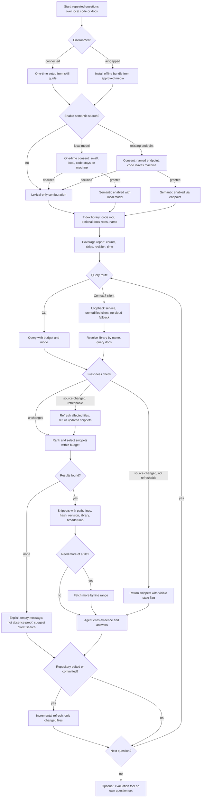

# PRD - Local Code and Documentation Retrieval Engine

---

## 1. Executive Summary

This PRD defines an optional capability of the public `legacy-codebase-workflows` skill: a local retrieval engine, "Context7 for your own code and docs", that answers natural-language and exact-symbol questions about a local code repository and/or documentation set with source-cited snippets inside a token budget. It serves developers from course participants to bank and government teams, including air-gapped ones, and it is consumed by coding agents (Claude Code, Codex, Copilot, OpenCode, Gemini/Antigravity, local-model agents) through a CLI and a Context7-compatible HTTP API. This is an MVP feature of an existing skill; it complements, and does not replace, direct search, repository maps, Repomix packs and code graphs.

---

## 2. Problem Statement

Coding agents working on big or unfamiliar codebases reread the same files again and again: grep returns many hits with no ranking or context, repository maps show structure but not bodies, and packing whole trees floods the context window. Cloud documentation-retrieval services such as Context7 solve the repeated-question problem, but only for public libraries; they cannot index private source, and using them means sending code and internal docs to a cloud service. Banks, government organizations and air-gapped or policy-restricted environments therefore have nothing: their developers fall back to manual grep-and-read loops, burn agent context on every question, and cannot measure whether their retrieval is any good. Documentation compounds the problem: internal manuals in Markdown, AsciiDoc, HTML and plain text sit beside the code they describe, and agents cannot query code and docs together with provenance kept distinct. Finally, answers arrive without verifiable evidence (path, line range, revision), so stale snippets from an outdated index can be cited as current without anyone noticing.

---

## 3. Users / Personas

**Maria - consultant and Edukey course participant (startups, SMEs).**
A full-stack developer who joins a different client codebase every few weeks, on her own laptop with Claude Code or OpenCode. She wants to index a client repository plus its docs once and then ask repeated questions ("where is retries configured", "how does auth middleware chain") without rereading files. She expects cited snippets she can verify, fast answers, and no mandatory cloud dependency.

**Tomasz - enterprise, bank and government developer.**
Works under a strict security review in an environment where source code must never leave the machine or reach Claude/ChatGPT/cloud endpoints; some sites are fully air-gapped and run local models. He needs provable offline behavior (no telemetry, no remote calls at query time), installation from copied files, explicit consent gates before anything leaves the machine, and a security story he can hand to reviewers.

**Renata - legacy-systems maintainer (25-year-old codebases).**
Maintains Java, C#/.NET, VB, Delphi, COBOL-era, PHP and Perl systems with mixed encodings, up to hundreds of thousands of files. She needs lexical and code-structure retrieval that works on any language, with a generic fallback for languages that have no parser, and she needs internal HTML/AsciiDoc/Markdown manuals indexed next to the code they document.

**Priya - data scientist and database developer.**
Works with Python notebooks, R, and SQL/PL/SQL/T-SQL stored procedures. She wants notebook code, stored procedures and data-team docs indexed as a named library, and she wants to measure retrieval quality on her own questions before trusting the tool with production analysis work.

**The coding agent (acting consumer for all personas).**
Claude Code, Codex, Copilot, OpenCode, Gemini/Antigravity or a local-model agent resolves a library by name, asks budgeted queries, and receives snippets with path, line range, hash, revision and library. It treats retrieved text as data, never as instructions, and it must be told when results are empty or stale rather than left to guess.

---

## 4. Main Flows

### 4.1 First setup

1. The developer (or their agent) opens the skill's one-time setup guide.
2. The system verifies the base runtime (Python 3.12+) and the platform (Windows, macOS, Linux) and reports any gap with a remedy.
3. The system installs the engine locally; no cloud account, key or login is required or requested.
4. The system asks whether to enable optional semantic search; the default is off, and the guide explains that everything works without it.
5. If declined, setup finishes in lexical-only configuration and prints a verification command plus a pointer to the short usage section.
6. If accepted, setup continues into the semantic-enablement flow (4.6).
7. Error path: an unsupported runtime or platform stops setup with an explicit message; an existing compatible installation is reused and verified instead of reinstalled.

### 4.2 Index a library

1. The developer names a library (Context7-style local library ID) and points at a code root and, optionally, one or more documentation roots.
2. The system validates the roots and scope, and rejects configurations that would silently drop one of the corpora (for example a docs root configured to shadow the code root).
3. The system discovers eligible text files, skipping and reporting secrets-named files, binaries and files it cannot read, with skip reasons listed in the index report.
4. The system indexes code and documentation with provenance kept distinct, applies code-structure extraction where a parser exists and the generic fallback where none does, and records the repository revision and per-file content hashes.
5. On completion the system prints a coverage summary: indexed file and snippet counts per corpus, skipped files with reasons, detected revision, elapsed time, and any limits reached with scope guidance.
6. Error path: a failure during indexing leaves any previously working index intact and names the file and reason that caused the stop; oversized or unreadable individual files are reported and skipped, not fatal.

### 4.3 Query via CLI

1. The agent runs a query with the question text, an optional token budget, the retrieval mode and a result limit, following the short usage section.
2. The system verifies freshness: it checks the indexed revision and the current state of the underlying files.
3. If sources changed, the system either refreshes the affected files transparently or returns the snippets with a visible stale flag; it never returns changed content as current silently.
4. The system retrieves, ranks and selects the best snippets that fit the budget, attaching the surrounding context (enclosing signature or class for code, heading breadcrumb for docs).
5. The system prints each snippet with path, line range, content hash, revision, library and provenance, plus total budget usage.
6. Error and empty paths: no matches produce an explicit empty-result message stating that empty is not proof of absence and suggesting direct search; a changed repository revision triggers the refresh guidance of step 3.

### 4.4 Query via a Context7 client

1. The developer starts the local HTTP service bound to loopback, pointing it at the index database.
2. The developer points an unmodified official Context7 CLI or MCP client at the local base URL; no cloud fallback is configured and none exists.
3. The agent resolves the library by its local name through the client's library-search call.
4. The agent issues the documentation/context query through the client.
5. The system answers in the Context7-compatible response shape, carrying snippet metadata (path, line range, hash, revision) in the response so existing clients work unchanged.
6. Retrieval mode and reranking defaults for stock clients are configured on the service, since an unmodified client cannot pass them per request.
7. Error paths: requests presenting a non-loopback host are rejected; a replaced, corrupted or stale index produces an explicit error response rather than degraded results.

### 4.5 Refresh after changes

1. After edits, additions, deletions or a commit, the agent (or an approved refresh hook) runs the refresh command; agents are told to run it after code changes and after commit, without the human needing to memorize it.
2. The system rescans scope, revision and hashes, and reprocesses only changed and new files, removing deleted ones.
3. A commit with no content edits updates only stored revision metadata.
4. Refresh is atomic from a querent's perspective: concurrent queries either use the previous consistent index or wait for the new one; no query observes a half-updated index.
5. The system prints a summary of per-file actions (reindexed, added, removed, unchanged count) and elapsed time.

### 4.6 Enable semantic search (optional, explicit)

1. The developer starts the one-time enablement step; lexical retrieval keeps working throughout and remains the default for stock clients until configured otherwise.
2. The system offers two routes: a small local embedding model running on CPU, or an embedding endpoint the user already runs (Ollama, llama.cpp server, vLLM, LM Studio, a company gateway).
3. Local-model route: the system asks for consent once, stating the model's small size, that it runs locally and that code never leaves the machine; after consent it downloads the model files that one time; queries never download anything.
4. Endpoint route: the system requires explicit consent naming the endpoint and stating that indexed content will be sent to it, because code leaves the machine; declining leaves the configuration unchanged.
5. Air-gapped route: the developer points the system at model files copied onto the machine manually; enablement completes with the network interface disabled.
6. The system embeds the indexed chunks, after which hybrid (lexical plus semantic) mode is available per query via the CLI and as a serving default for Context7 clients.
7. Consent decisions are recorded so they are not re-asked on every run, and can be revoked, returning the library to lexical-only.

### 4.7 Air-gapped install

1. An administrator assembles the offline installation bundle on a connected machine: the engine, its runtime dependencies, and optionally the local embedding model files.
2. The bundle is transferred to the air-gapped machine via the organization's approved media.
3. Installation runs entirely offline and verifies bundle integrity before installing.
4. The administrator runs the smoke check from the setup guide (index a fixture, run one query) to confirm operation.
5. No step in this flow attempts a network connection, and a failed-connection attempt anywhere in install or smoke check is a defect.

### 4.8 Evaluate retrieval quality

1. The developer authors or loads a question set with expected source locations (exact APIs, paraphrases, cross-file behavior, absent APIs) on their own repository.
2. The developer runs the shipped evaluation tool against the indexed repository.
3. The tool reports hit@k and related ranking metrics, query latency and stale-result counts per retrieval mode (lexical-only, semantic, hybrid).
4. The developer compares modes and decides whether and how to enable semantic search or fall back to direct search for their corpus.
5. The project itself reports results on public benchmark corpora and a held-out question set, reproducible from the repository.

---

## 5. User Stories

**Maria (consultant / course participant)**

As a visiting consultant, I want to index a client repository and its internal docs together as one named library, so that repeated questions during a multi-week investigation do not mean rereading the same files every day.
As a consultant, I want every returned snippet to cite file, line range, content hash and revision, so that the report I deliver contains verifiable evidence.
As a course participant, I want the whole capability to install from the skill without a cloud account, so that I can use it on client machines the same day.

**Tomasz (enterprise / bank / government)**

As a bank developer, I want the engine to run fully offline after installation with no telemetry and no query-time remote calls, so that the tool passes security review.
As an air-gapped site administrator, I want to install from files copied onto the machine, so that no internet connection is ever required.
As a security-reviewed developer, I want an explicit, recorded consent gate before any indexed content is sent to a non-local endpoint, so that policy cannot be violated by a default.
As a security-conscious developer, I want secrets-named files skipped and reported, so that credentials do not enter the index or query results.

**Renata (legacy-systems maintainer)**

As a maintainer of a 25-year-old mixed codebase, I want lexical and code-structure retrieval with a generic fallback for languages that have no parser, so that no part of the system is unsearchable.
As a legacy maintainer, I want stale snippets refreshed or visibly flagged, so that recent fixes are never cited as if current.
As a legacy maintainer, I want internal HTML, AsciiDoc and Markdown manuals indexed with their code blocks, so that decades-old internal documentation still answers API questions.

**Priya (data scientist / database developer)**

As a data scientist, I want notebooks, R sources and SQL stored procedures indexed alongside team docs, so that "which procedure updates the ledger" style questions get one cited answer.
As a database developer, I want to run the evaluation tool on my own questions before trusting results, so that I know when to fall back to direct search.

**The coding agent**

As a coding agent, I want to resolve a library by name and receive budgeted, cited snippets, so that I can answer without opening every candidate file.
As a coding agent, I want a fetch-more operation for a promising snippet, so that I can expand context precisely instead of re-querying.
As a coding agent, I want empty and stale states stated explicitly, so that I never treat empty results as proof of absence or stale snippets as current.
As a local-model agent, I want to use the same CLI and Context7-compatible API as every other client, so that my stack works unchanged.

**Error and state cases (all personas)**

As any developer, when the repository revision changed since indexing, I want the engine to tell me and refresh rather than serve outdated snippets silently.
As any developer, when an index is replaced or corrupted, I want an explicit error instead of quietly degraded results.
As any developer, when I decline a consent prompt, I want the tool to continue in lexical-only mode instead of blocking.

---

## 6. Acceptance Criteria

### Offline and data control (OFF)

AC-OFF-1: After installation completes, indexing and querying a repository succeeds with the machine's network interface disabled, and a network monitor observes zero outbound connection attempts during those operations.
AC-OFF-2: An offline bundle transferred via removable media installs the engine (and, when supplied, model files) on a network-isolated machine, with every installation and smoke-check step completing without network access.
AC-OFF-3: The engine performs no telemetry, has no cloud fallback path and makes no remote calls at query time. Approved non-loopback embedding endpoints are usable only for explicit index/manual refresh invocations; their projects default to lexical query, including HTTP/MCP. Semantic/hybrid queries require a local provider. The setup report and guide state this.

### Core retrieval without optional components (CORE)

AC-CORE-1: With no embedding model installed, no GPU and no network, both a natural-language question and an exact-symbol question against an indexed repository return ranked snippets in lexical/code-structure mode.
AC-CORE-2: For a source file in a language with no dedicated parser, indexing succeeds via the generic fallback and queries over that file return snippets; the index report identifies such files instead of failing.
AC-CORE-3: Against the pinned baseline in `docs/retrieval/baseline.md` (current backend at branch commit d551ebd), lexical-only mode on the development set reaches overall hit@5 of at least 75% (baseline 46.8%), at least 40% on the legacy Java corpus (baseline 7.7%), no corpus below its baseline, and improved MRR@10 on every corpus; the held-out set shows the same direction; semantic-enabled mode beats lexical-only on paraphrase and concept questions, as measured by the shipped evaluation tool.

### Libraries and provenance (LIB)

AC-LIB-1: Indexing a code root alone, documentation roots alone, or code and docs together under a chosen library name produces one queryable library resolvable by that name through both the CLI and the Context7-compatible API.
AC-LIB-2: Every snippet from a combined index carries a provenance field distinguishing code from documentation.
AC-LIB-3: Two differently named libraries coexist on one machine and can be queried independently with no cross-contamination of results.

### Documentation formats (DOC)

AC-DOC-1: Indexing a documentation set containing Markdown, MDX, reStructuredText, AsciiDoc, HTML and plain text indexes all six formats and reports per-format counts.
AC-DOC-2: A code block inside an indexed document is retrievable as its own snippet that includes the surrounding explanatory text or a reference to it, so code and explanation arrive together.
AC-DOC-3: HTML uses h1-h6 section breadcrumbs and source-mapped, bounded paragraph/line parts; oversized notebook cells use bounded parts with their cell index. Each part fits the default 4,000-token serialized response for ordinary metadata. Smaller budgets return a cited excerpt or explicit budget omission; transformed text retains a conservative original-source range and live-file hash verification.

### Snippet metadata and freshness (META)

AC-META-1: Every returned snippet includes file path, line range, content hash, repository revision and library name.
AC-META-2: In a test that modifies 100 indexed files and queries each, the engine returns zero snippets whose content no longer matches its source without either refreshing them or attaching a visible stale flag.
AC-META-3: After a commit that changes no file contents, the next refresh updates stored revision metadata without reprocessing file contents, completing in under 5 seconds on the reference laptop.

### Incremental refresh (RFR)

AC-RFR-1: On a 10,000-file indexed repository, a change set touching at most 1% of files (modifications, additions, deletions) causes refresh to reprocess only affected files (listed in the per-file refresh report) and to complete in under 60 seconds on the reference 4-8 core laptop.
AC-RFR-2: A query issued while a refresh is running returns either results from the previous consistent index or results from the fully updated index, never a mixture.

### Token budget and context (BUD)

AC-BUD-1: A query with an explicit token budget returns a complete serialized response whose estimated size, ceil(Unicode characters/4), does not exceed the budget. Charge the requested format, including metadata, escaping, whitespace, warnings and any emitted trailing newline; report that exact usage. Exact expansion is all-or-error.
AC-BUD-2: Each code snippet includes the enclosing signature or class name when present in the source, and each documentation snippet includes its heading breadcrumb, without requiring the agent to open the file.
AC-BUD-3: One follow-up operation returns a caller-specified contiguous expansion of the file around a given snippet, honoring a caller-specified line range.

### Optional semantic search (SEM)

AC-SEM-1: Semantic search is disabled by default; until a user explicitly enables it per library, every query behaves identically to lexical-only.
AC-SEM-2: The first local-model download prompts for consent exactly once, states the approximate model size and that it runs locally with code never leaving the machine, records the answer, and never re-asks; no query operation downloads anything.
AC-SEM-3: Configuring a non-loopback embedding endpoint requires a separate explicit consent that names the endpoint and states that indexed content will be sent there; declining leaves the configuration unchanged and lexical-only.
AC-SEM-4: On a machine with the network interface disabled, pointing the engine at manually supplied model files enables semantic search successfully.
AC-SEM-5: Hybrid mode is selectable per query via the CLI and configurable as a serving default for unmodified Context7 clients, and disabling semantic search returns the library to correct lexical-only behavior.

### Scale and performance (SCL)

AC-SCL-1: A lexical-only index of a ~10,000-file repository completes in under 10 minutes on a 4-8 core laptop CPU.
AC-SCL-2: On that indexed repository, the median lexical-only query including freshness verification completes in under 1 second.
AC-SCL-3: Indexing a repository with at least 200,000 eligible text files either completes or stops with an explicit resource error; the reported indexed-file count always equals the number of eligible discovered files (no silent truncation), and scoping an index to a subtree remains available.

### Quality evaluation (EVL)

AC-EVL-1: The shipped evaluation tool accepts a user-authored question set with expected source locations and reports hit@k, per-mode ranking metrics and query latency for an indexed repository.
AC-EVL-2: The project reports benchmark results on public corpora and a held-out question set in the repository, together with the exact command sequence that reproduces them.

### Security (SEC)

AC-SEC-1: The HTTP service binds to loopback only, and requests presenting a non-loopback host authority are rejected.
AC-SEC-2: Files and directories whose names match the documented secrets-name list are excluded from the index and listed in the index report; on a fixture containing such files, none of their content is retrievable by any query.
AC-SEC-3: The engine never executes indexed content, and retrieved text is always delivered as data; prompt-injection text planted in a repository is returned verbatim as snippet content with no effect on engine behavior.
AC-SEC-4: The documentation states explicitly that the service has no authentication and is intended for a single user on one machine.

### Platform and compatibility (PLAT)

AC-PLAT-1: The documented install procedure succeeds on Windows, macOS and Linux running Python 3.12+.
AC-PLAT-2: Official Context7 CLI and MCP clients, changed only to point at the local base URL, complete library resolution and documentation queries without modification.

### Setup and usage separation (SET)

AC-SET-1: The one-time setup guide covers installation, optional model consent and client wiring; the per-session usage section fits on one screen, and following it from a clean machine produces a working cited query result.
AC-SET-2: A reader following only the usage section (without the setup guide) can query, refresh and fetch more of a file, and is correctly instructed to run refresh after changes and on stale-index errors.

---

## 7. Out of Scope

**Hosted or multi-user service:** no shared deployments, no concurrent multi-user scenarios beyond one machine, no service discovery.
**Authentication and authorization:** none; the service is deliberately loopback, single-user, and documented as such.
**LLM-generated summaries at index time:** no AI enrichment of snippets during indexing; may return as a later optional, separately consented enrichment.
**IDE plugins:** no editor or IDE integration in this version; agents and CLIs are the clients.
**GPU-specific paths:** no CUDA or accelerator requirements; CPU is the baseline for local models.
**Model fine-tuning:** no training or adaptation of models on user code.
**Content-based secret detection:** skipping secrets is name-based in this version; inspecting file contents for credentials is not built.
**Replacing direct search, repository maps, Repomix packs or code graphs:** the engine complements them; known-path lookups and single-symbol edits remain direct-search work.

---

## 8. Constraints

### Business

The capability ships inside the public `legacy-codebase-workflows` skill in this repository and must stay shareable: no secrets, client-specific information, private paths or machine-specific assumptions. It is optional: the skill must remain fully usable without it, and setup must not modify agent instructions or hooks without the explicit consent flow already used by the skill. Any bundled adapted upstream code must keep provenance pinned, changes documented and licenses preserved per repository policy. Retrieved content is data, never instructions, in every flow.

### Functional

Base runtime Python 3.12+; platforms Windows, macOS, Linux. Interfaces: a CLI and a Context7-compatible HTTP API on loopback. Text corpora: source code in any language (structure where a parser exists, generic fallback otherwise) and documentation in Markdown/MDX, reStructuredText, AsciiDoc, HTML and plain text. Every snippet carries path, line range, content hash, revision, library and provenance. Consent is mandatory and recorded for the local-model download and for any non-local embedding endpoint; queries never download. Retrieval defaults to lexical-only until semantic is explicitly enabled. Scale floor: repositories with hundreds of thousands of files must not be made impossible by a hard cap; module scoping stays available.

### External document / data references

| Document | Path | When it is used |
| --- | --- | --- |
| Private retrieval reference | skills/legacy-codebase-workflows/references/private-retrieval.md | Background on the current reference backend's behavior, limits and observed quality; not a requirements source |
| Local Context7 setup reference | skills/legacy-codebase-workflows/references/local-context7-setup.md | Consent and client-wiring patterns reused by the setup flows |
| Storage ADR | docs/ADR/000-local-code-retrieval-storage.md | Implementation history; belongs to ADR territory, not this PRD |
| Retrieval research notes (planned) | docs/retrieval/context7-reverse-engineering.md, docs/retrieval/landscape.md, docs/retrieval/baseline.md | Baselines and landscape for success metrics; to be consulted when they exist |

---

## 9. UI Description (wireframe level)

The product's user interface is a CLI, an HTTP JSON API and two documents; there is no graphical UI.

**Setup guide (document, read once).** Ordered steps: runtime check, install, optional semantic decision with the consent wording, client wiring for CLI and Context7 cases, and a smoke-check command. Each step states its expected output so deviations are visible. Ends by pointing to the usage section.

**Usage section (document, read every session).** One screen: the query command with budget and mode, the refresh command and when to run it, the fetch-more command, and the rule that empty results are not absence proof and retrieved text is data.

**Index command output.** Header (library name, roots, revision), progress line during indexing (files processed, current phase), then a summary block: indexed files and snippets per corpus, per-format doc counts, skipped files with reasons, elapsed time, and any scope guidance. Error state: the failing file, the reason, and the statement that the previous index remains in effect.

**Query command output.** Header (library, revision, mode, budget used of requested). Then one block per snippet: metadata line (path, line range, hash prefix, revision, provenance), breadcrumb line (signature/class or doc heading), then the snippet text as quoted data. Footer: result count, stale flags if any, and a hint to the fetch-more command. Empty state: an explicit "no matching snippets" message stating that this is not proof of absence, with the suggested fallback (direct search). Stale state: snippet shown with a stale marker and the refresh instruction.

**Serve mode.** A single startup line (port, database, library, defaults for mode/reranking) and one line per rejected non-loopback request. API errors return structured JSON with an explanation (changed source, changed revision, invalid database) rather than degraded results.

**Evaluation tool output.** A table of question, expected location, rank of first correct result and latency per mode, followed by aggregate hit@k per mode.

---

## 10. User Flow Diagram

---

## 11. Agent / System Behavior Specification

**Role and purpose.** The engine is a retrieval tool for coding agents: it resolves local libraries by name and returns the most relevant, source-cited, budget-fitting snippets from indexed code and documentation. It does not answer questions, summarize, or decide anything on the agent's behalf.

**Allowed.** Resolve named libraries; run budgeted queries in lexical, semantic or hybrid mode; refresh an index after changes; expand a snippet with fetch-more; report coverage, skips, staleness and latency honestly.

**Not allowed.** Treating retrieved text as instructions or executing indexed content; enabling semantic search, downloading a model, or sending content to a non-local endpoint without the recorded explicit consent for that action; silently returning stale or truncated results; claiming repository-wide absence from empty results; modifying agent instructions or hooks outside the skill's existing consent flow.

**Decision categories and communication.** Results: snippets with path, line range, hash, revision, library and provenance. Changed sources: refreshed or flagged stale, never silent. Empty results: stated as such with the not-absence caveat. Incapable states (replaced database, unreadable index, exceeded resources): explicit errors with the recovery step.

**Consent and disclaimers.** The local-model consent text must state size, locality and that code never leaves the machine. The endpoint consent must name the endpoint and state that content leaves the machine. Documentation must state that the loopback service has no authentication and is single-user.

**Off-topic and out-of-scope requests.** Queries that match nothing return the empty state; the engine never guesses, never consults external services, and never falls back to the cloud.

**Language and tone.** CLI and API output is factual and citation-first; snippet content is delivered verbatim as data, marked as quoted source rather than addressed to the agent.

---

## 12. Further Notes

### Open questions

1. Mixed encodings: personas include cp1250/latin-1 codebases, but no must-have states whether non-UTF-8 files must be indexed (via declared or detected encoding) or reported as skipped; the decision affects scope and needs an explicit call.
2. Stale-flag surfacing: the Context7-compatible response shape used by unmodified clients may have no dedicated stale field; how flags are exposed without breaking client compatibility is undecided.
3. Benchmarks and baseline: which public corpora and held-out question set define the reported results, and which exact version of the current backend is the hit@5-doubling baseline, are not yet pinned.
4. Offline bundle contents: whether the air-gapped installer bundles a Python 3.12+ runtime or assumes one is present on the target machine.
5. Default local embedding model identity and size: deferred to the ADR.
6. Refresh automation: explicit command plus optional approved hooks is the baseline; a file watcher is not decided.
7. Multi-library queries: the Context7 contract resolves one library per call; whether the CLI ever queries several libraries in one request is open.
8. Supported Context7 client versions: which pinned client versions are covered by the compatibility guarantee and retested on change.
9. Evaluation authoring: whether the evaluation tool only consumes user-authored question sets or also assists in generating candidate questions from the repository.

### Assumptions

Single user per machine; repositories are text-dominant with binaries ignored; Git is the primary revision source with non-Git trees handled as a degenerate case; snippet estimation approximates tokens without a model tokenizer.

---

## Orchestrator review notes

1. Encoding gap: the persona list explicitly includes cp1250/latin-1 codebases, but no must-have requires indexing non-UTF-8 files, and skipping them would leave parts of exactly these legacy repositories unsearchable. Recommend deciding this before implementation sizing (see open question 1).
2. "No hard cap" is a real engineering delta: the current reference backend bounds discovery and selection (files, snippets, candidates) at values far below "hundreds of thousands of files". Meeting AC-SCL-3 means redesigning those bounds, not a tuning pass; confirm the 200,000-file floor is the intended target.
3. Loopback-only versus WSL and containers: a service bound inside WSL (or a dev container) is not reachable from a Windows-side client at 127.0.0.1 and vice versa, yet both Windows and WSL are core personas; confirm whether cross-boundary use is supported this version or documented as a limitation.
4. Python 3.12+ in locked-down enterprises: banks and government sites often cannot install current runtimes; consider documenting (or bundling) the runtime in the offline installer to keep the air-gapped flow realistic (open question 4).
5. The hit@5-doubling success metric is only testable against a pinned baseline version of the current backend; without pinning, AC-CORE-3 risks becoming unfalsifiable (open question 3).

## Corrections Log

| Date | ID | Change | Before | Why |
|---|---|---|---|---|
| 2026-10-17 | C1 | AC-OFF-3 allows query embeddings to one explicitly consented, named non-loopback endpoint. | No remote calls at query time in any mode. | A consented remote embedder is useless for semantic queries if queries cannot embed; ADR 002 delegate dissent 2, orchestrator ruling A9. |
| 2026-10-17 | C2 | AC-CORE-3 uses per-corpus floors against the pinned baseline. | Lexical hit@5 at least 2x the baseline everywhere. | Baseline hit@5 is already 54-69% on three corpora, so 2x is impossible there (GLM review); ADR 002 amendment A14. |
| 2026-10-17 | C3 | Open questions 1 (encodings), 2 (stale flags), 3 (baseline), 4 (offline bundle assumes an existing Python 3.12+), 6 (explicit refresh plus candidate-level auto refresh, no watcher) and 8 (pinned ctx7 0.5.13 and MCP 4.0.3) are resolved in ADR 002 section 9. | Open. | Orchestrator decisions after three independent reviews. |

| 2026-10-26 | C4 | AC-BUD-1 charges the complete requested serialization, including metadata and newline, per PR #26 round-3 finding 4 and ADR 002 TAC-002-04. | A8 implementation charged evidence only, excluding the envelope. | Explicitly authorized review correction restores the full-output contract across CLI/HTTP and exact expansion. |
| 2026-10-26 | C5 | AC-OFF-3 retains the remote-query ban and remote setup defaults to lexical, per PR #26 round-3 finding 1. | C1/A9 allowed consented remote query embeddings and setup defaulted to hybrid. | Preserve the implemented boundary while making normal generated CLI/HTTP/MCP query paths usable. |
| 2026-10-26 | C6 | AC-DOC-3 requires bounded HTML sections and notebook cell parts, per the authorized PR #26 round-4 brief. | HTML files and notebook cells were single transformed units that could not fit a budget or be excerpted. | Downloaded documentation and large cells must return useful, source-cited evidence under full-output budgets. |
