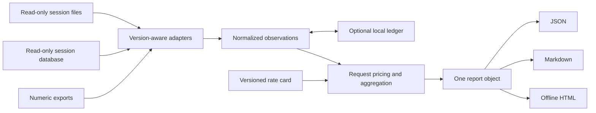
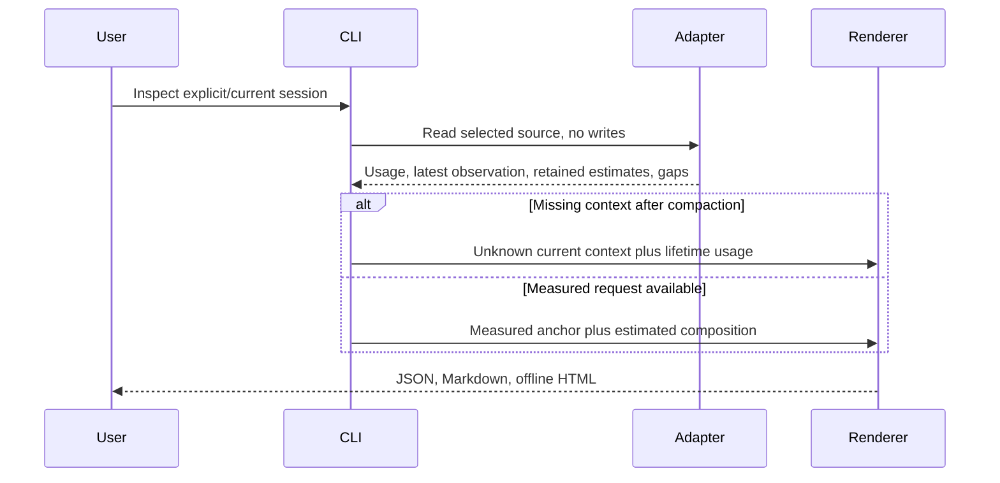

# ADR-001 - Evidence, accounting and local history

Date: 2026-10-17

Status: accepted under the user's delegated decision authority. Requirements: [PRD.md](PRD.md). Initial design: [design.md](design.md). Expert review disposition: [review-decisions.md](review-decisions.md).

## Decision

Use a Python 3.11+ standard-library CLI with independent adapters, a content-free normalized dataset, an optional SQLite history ledger and a single report object shared by JSON, Markdown and offline HTML renderers. Analysis does not call a model or require an API key. Optional live account collection uses the owning CLI's documented read-only interface.

The user explicitly authorized expert consultation followed by documentation, implementation and real-session testing. Routine decisions are owned by the implementing agent. The documents record them before code; no new approval gate is introduced.

## Modules and dependency direction

The CLI depends on collection, accounting, history and rendering. Adapters depend only on the shared normalization helpers. Accounting consumes normalized observations, never raw transcript content. Rendering consumes the report object, never source files. The ledger stores normalized observations and has no connection to provider databases.

Implementation is confined to `skills/agent-usage-analytics/`, `tests/usage-analytics/`, its Node discovery wrapper, its dedicated CI workflow and these documentation files. Root README edits only add discovery and install information. The legacy skill agent retains ownership of its paths and active checkout.

## Normalized contracts

Each dataset has schema version 1 and these lists: `usage`, `contexts`, `tools`, `quotas`, `sessions`, `sources`, `warnings`. A normalized import is accepted only through an allowlisted field projection and schema validation; arbitrary supplied fields are never forwarded into reports.

| Entity | Required meaning and important fields |
| --- | --- |
| Usage | Stable `id`, agent, session ID, model or unknown, timestamp or unknown, source identity, origin, input including cache reads/writes, separate cache read/write counts, optional write TTL split, output including reasoning when established, informational reasoning subset, request count, quality and accounting caveats |
| Context | Observation identity and time, session, raw used/window counts, explicit basis, provider percentage when supplied, optional baseline exclusion, estimated visible categories, compaction count, retention quality and unknown overhead |
| Tool/skill | Stable invocation identity, session, time, safe name, kind, argument/result character counts and estimation method; no command or result text |
| Quota | Agent, explicit account alias, bucket, window duration, reset time, used percentage, observation time and origin; no credential or account identity |
| Session | Session identity, agent, device alias, time range and compaction metadata; no prompt summary generated from private text |
| Source | Hash-based source identity, agent, device alias, documented/observed/imported contract, files/rows seen and parsing coverage |
| Warning | Fixed code, source identity, optional line and numeric detail; no source line or exception content |

Missing numeric fields remain null. Aggregates carry known totals and missing-record counts; incomplete totals are labeled lower bounds. `input_tokens` is normalized to include cache reads and writes, so ordinary input is input minus those two components. A negative result is an anomaly, not a silent successful correction. Reasoning is never added to output again.

Timestamps are aware UTC internally. Calendar grouping defaults to UTC for reproducibility across machines. An explicit IANA timezone must resolve or fail with an explanation; Windows users can choose UTC without installing `tzdata`. Date-only end bounds mean the start of that date, and all intervals are half open.

## Codex source precedence

Native per-response records are authoritative for their covered requests. Join `turn_id` to the recorded turn context for model attribution; use an explicitly marked preceding-context fallback only when necessary. The envelope supplies the timestamp. Sum `usage`, deduplicate response identity within its thread, and use thread totals only for reconciliation.

Legacy cumulative snapshots supply deltas, never a sum of repeated last-usage fields. Skip equal totals and flag counter decreases. At a native/legacy transition, the first native thread total minus that response's usage establishes how much earlier usage could already be covered. Include only a reconciled pre-native span; never add the first native response twice. If a boundary cannot be reconciled, retain native measurements and flag the uncertain earlier span.

Some forked rollouts retain parent metadata before their own metadata. The last establishing session metadata, cross-checked with the filename identity when present, determines file ownership. Earlier metadata and snapshots establish lineage/baselines rather than new child usage.

Forked native records are the child's own usage. Legacy replay is matched against the parent when available; otherwise inherited baselines are treated as uncertain rather than charged again. Inferred legacy attribution is labeled reconstructed. Parent and child summaries remain cross-checks.

`rate_limits` on repeated token events remains useful even when the usage delta is zero. Quota observations are extracted independently. Local rollout-budget fields are excluded from subscription quota analysis.

## Claude source precedence

Coalesce assistant records globally by message ID plus request ID, taking field maxima for repeated/partial streaming entries. Same message ID with a different request ID is a separate request. Entries lacking stable identity are flagged as non-deduplicable; synthetic entries are excluded.

Claude fresh input, cache creation and cache reads are separate provider counters. Sum them for normalized input. Preserve 5-minute and 1-hour cache-write splits when supplied. An absent TTL split produces a cost range. Sidechain/subagent requests are real usage, with lineage where recorded, and are not added again from parent summaries.

## Copilot and additional sources

Copilot JSONL with request identity is the preferred local request source. SQL schemas are inspected against required column/type contracts; unknown extensions do not invalidate known fields, but missing or incompatible required fields prevent accounting. Source schemas are observed-local contracts, explicitly distinct from public documented guarantees.

SQL reads use `mode=ro` and an in-memory backup for a consistent WAL-aware snapshot. Queries are fixed allowlisted statements. With no shared request identity, alternative SQL/JSONL totals are reconciled at session scope: prefer the higher-resolution source, report unmatched coverage, and never add both sets on speculation. SQL-only sessions remain useful.

Hosted Copilot SQL is an import recipe based on the host's available tool/schema, not a promised endpoint. AGY accepts documented JSON/stream exports; cumulative results and per-step counts are alternative evidence. Ambiguous cache/reasoning semantics remain unavailable for exact pricing. Grok Build supports verified turn-level `usage.json` observations and context signals as an observed contract; inherited whole-session summaries are not summed into turns.

## Current context

A context chart is anchored to the latest measured request, with its timestamp and basis. Codex's protocol uses input plus output for its last-request total; Claude's native status percentage uses input only. Provider percentage is preserved separately from computed raw occupancy. Any Codex display-baseline formula is explicitly a versioned estimate, not an observed provider percentage or a universal reserve.

Reconstruct only recorded retained history. A Codex replacement history replaces the earlier content inventory. A compaction without a reconstructable replacement invalidates the inventory; after a compaction with no subsequent request, measured context is unavailable. Claude inventories start at a recorded compaction boundary and remain estimates.

Visible text uses an explicitly named character heuristic with a broad uncertainty band. It is a diagnostic size estimate, not provider tokenization. Hidden schemas, hidden prompts, multimodal payloads and encrypted reasoning are unknown. The chart has an unattributed residual and displays estimation overrun without scaling categories to force agreement. Tool and skill counts describe observed content and invocations, not causal model charges.

## Pricing

Price individual request observations before aggregation. Rate cards have version, verified date, official URL, exact model/explicit aliases, effective interval when established, prompt-length tiers and independent bucket prices. Rates may be supplied separately from code. Unknown effective history is labeled a reference-rate comparison, not historical invoice reconstruction.

Per-request costs include the applicable prompt tier, speed/service tier, inference geography and cache-write TTL. Missing dimensions produce a range or unpriced coverage. Provider-specific tool fees and billing credits are separate; do not convert nano-AIU or subscription percentages into dollars without a supported contract. Unknown models remain unpriced.

## Local history and quotas

Retain optional SQLite because the user requested automated repeat collection and comparisons, including deleted or rotated logs. It stores normalized measurements only, using transactional upserts and a schema-version check. Repeated identical imports do not increase counts. Source databases are never modified. Concurrent-writer and Windows tests are mandatory. An append-only snapshot directory was considered but rejected because reconciling multiple growing sources would require another deduplication/storage protocol.

Quota calibration is descriptive, not a recovered provider allowance. Require at least five compatible observations spanning five percentage points, one account/bucket/reset, monotone percentages, complete declared device/cloud coverage and stable model/speed scope. Otherwise show observations and local rolling totals without a calibrated allowance. Even eligible estimates display sample count, observed range and the assumption that the quota formula is unknown. Reset crossings are excluded. Forecasting future quota exhaustion is deferred.

## Privacy and share mode

Raw text is processed locally for lengths/category detection, then discarded. Prompts, responses, arguments, outputs, reasoning text, credentials, email addresses and account IDs do not enter the normalized output contract. Source files use hashed references by default. Local session/tool/skill names remain useful identifiers; `--share` replaces potentially identifying labels with stable pseudonyms. Model IDs, numeric measurements and source quality remain readable.

Imported labels are data and escaped in Markdown/HTML. JSON embedded in HTML escapes script-breaking characters. Neither HTML nor normal collection fetches external resources. Account collection starts the owning CLI and requests only documented read methods; it does not read authentication files or consume a model turn.

## Testing strategy

Synthetic fixtures have hand-computed totals, independent of the implementation. Cover native/legacy overlap, repeated snapshots, fork inheritance, resets, streaming groups, cache TTLs, mixed models, missing fields, invalid counts, live partial lines, BOM/CRLF, Unicode Windows paths, read-only SQL with WAL, duplicate imports, concurrent ledger writes, timezone/date bounds and HTML injection.

Real trials use numeric oracles from selected Linux and Windows sessions. Expected Codex totals come from unique native responses and are reconciled with thread totals; expected Claude totals come from independently coalesced request counters; Copilot SQL/event alternatives are compared without assuming equality means completeness. Real raw data is never committed. CI runs on Linux and Windows at Python 3.11 and a current stable version. The Node test discovery wrapper ensures repository-wide `npm test` also exercises the skill.

The dashboard is checked in a real browser for offline operation, console errors, filtering, totals, escaping, narrow layout and keyboard access. A realistic independent skill invocation verifies the instructions, artifact generation and truthful limitations.

## Technology documentation

| Technology | Verified reference | Purpose |
| --- | --- | --- |
| Codex | Context7 `/openai/codex`; [protocol](https://github.com/openai/codex/blob/main/codex-rs/protocol/src/protocol.rs), [app server](https://learn.chatgpt.com/docs/app-server) | Usage/context records and supported account reads |
| Claude Code | Context7 `/websites/code_claude`; [statusline](https://code.claude.com/docs/en/statusline), [monitoring](https://code.claude.com/docs/en/monitoring-usage) | Counter meanings and native observations |
| Pricing | [OpenAI](https://developers.openai.com/api/docs/pricing), [Claude](https://platform.claude.com/docs/en/about-claude/pricing) | Versioned rate cards |
| SQLite/Python | [sqlite3](https://docs.python.org/3/library/sqlite3.html) | Read-only snapshots and transactional local history |
| Copilot | [Session data](https://docs.github.com/en/copilot/how-tos/copilot-cli/use-copilot-cli/chronicle) | Documented locations and observed schema boundary |
| AGY/Grok | [AGY exports](https://antigravity.google/docs/cli/headless/), [Grok sessions](https://github.com/xai-org/grok-build/blob/main/crates/codegen/xai-grok-pager/docs/user-guide/17-sessions.md) | Import scope and cumulative usage caveats |

## Consequences and review triggers

The result is portable and useful with partial data, while context attribution and quota calibration remain explicitly conditional. Exact raw tokenization and missing cloud activity cannot be recovered by styling the report. Revisit native adapters when required schema fields change, pricing when official rate cards change, storage when multi-user sharing is requested, and the heuristic estimator when measured comparisons show unacceptable diagnostic error.
